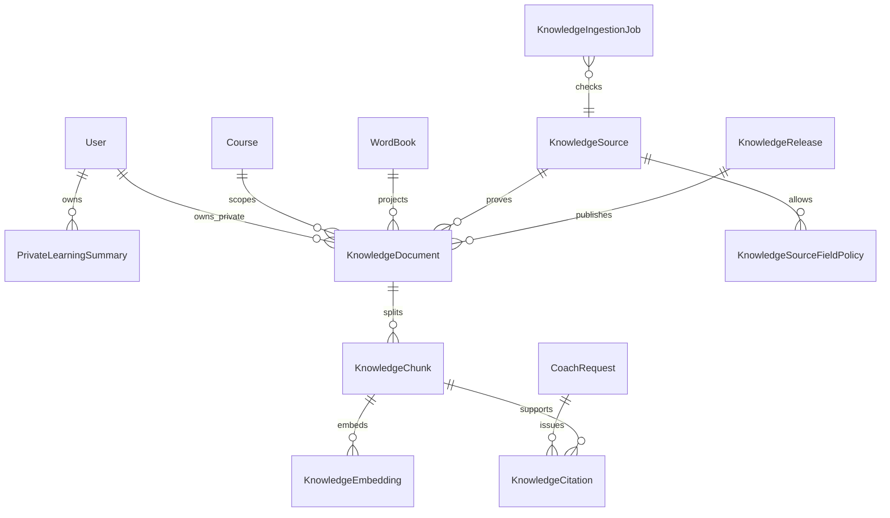

# Phase 1 Data Model: 英语学习知识库 RAG 与来源引用

**Feature**: `002-rag-source-citations`  
**Date**: 2026-09-08  
**Storage**: Existing primary PostgreSQL via Prisma 7.6 plus pgvector custom SQL

## Modeling Principles

1. 原始 `WordBook`、`Course`、练习、作答和学习状态仍是业务事实源；知识库只保存可删除、可重建的检索投影。
2. Source 权利、Document 内容版本、Chunk 切分版本、Embedding 兼容版本和 Release 激活状态彼此独立且都可审计。
3. 共享课程只存一份；`accessScope` 与 `CourseRecord` 决定读取权限。私有内容必须携带服务端 owner。
4. 只有 ACTIVE Source + ACTIVE Release + ACTIVE Chunk + READY compatible Embedding 的交集可检索。
5. Citation 是一次 Coach request 的证据绑定，不是永久内容副本；失效后保留非内容审计信息并清空摘录。
6. Prisma 管理关系和状态，只有 vector 值与距离运算使用参数化 raw SQL。

## Relationship Overview



Polymorphic source records are represented by `sourceRecordType + sourceRecordId`; optional direct relations to User/Course/WordBook are kept where Prisma foreign keys add deletion safety. The ingestion adapter must verify the polymorphic pair against the selected source type.

## Enums

### KnowledgeSourceStatus

| Value | Meaning |
|-------|---------|
| `DRAFT` | Rights record exists but cannot authorize ingestion. |
| `ACTIVE` | Verified and currently allowed for listed uses. |
| `SUSPENDED` | Temporarily unavailable; immediately excluded. |
| `EXPIRED` | Rights period ended; immediately excluded. |
| `REVOKED` | Authorization withdrawn; content derivatives must purge. |
| `DELETED` | Tombstoned source record. |

### KnowledgeAccessScope

| Value | Storage/authorization rule |
|-------|----------------------------|
| `PUBLIC` | `visibility=public`, `userId=null`; allowed to authenticated Coach users under source terms. |
| `OWNED_COURSE` | `visibility=public`, `userId=null`, `courseId!=null`; requires purchased `CourseRecord`. |
| `PRIVATE_OWNER` | `visibility=private`, `userId!=null`; only exact authenticated owner. |

### KnowledgeDocumentStatus

`STAGED`, `ACTIVE`, `SUPERSEDED`, `INVALID`, `PURGING`, `PURGED`

### KnowledgeChunkStatus

`STAGED`, `ACTIVE`, `SUPERSEDED`, `INVALID`, `PURGING`

### KnowledgeEmbeddingStatus

`PENDING`, `READY`, `FAILED`, `INVALID`, `PURGING`

### KnowledgeReleaseStatus

`BUILDING`, `READY`, `ACTIVE`, `SUPERSEDED`, `INVALID`, `PURGED`

### KnowledgeIngestionOperation / Status

- Operation: `UPSERT`, `REEMBED`, `INVALIDATE`, `PURGE`
- Status: `PENDING`, `DISPATCHED`, `RUNNING`, `SUCCEEDED`, `RETRYABLE_FAILED`, `TERMINAL_FAILED`, `CANCELLED`

### KnowledgeCitationStatus

`ACTIVE`, `SUPERSEDED`, `SOURCE_INVALID`, `ACCESS_REVOKED`, `SOURCE_DELETED`, `PRIVATE_DATA_DELETED`, `PURGED`

Any value other than `ACTIVE` is projected publicly as `unavailable`; internal reason is not exposed when it could reveal source existence.

## Entity: KnowledgeSource

Rights and provenance ledger for one approved content origin.

| Field | Type | Rules |
|-------|------|-------|
| `id` | String | CUID primary key. |
| `sourceKey` | VarChar(128) | Stable unique code, not a brand-field inference. |
| `name` | VarChar(300) | User-displayable source name. |
| `sourceType` | VarChar(64) | `WORD_BOOK`, `COURSE`, `GRAMMAR`, `EXERCISE`, `PRIVATE_SUMMARY`, or future approved adapter. |
| `licenseRef` | VarChar(500)? | Auditable contract/license reference; never a secret. |
| `rightsVersion` | VarChar(128) | Changes whenever permitted use changes. |
| `status` | KnowledgeSourceStatus | Only ACTIVE can publish/retrieve. |
| `allowEmbedding` | Boolean | Required true for vector generation. |
| `allowExcerptDisplay` | Boolean | Required true for user Citation excerpt. |
| `allowEvaluation` | Boolean | Required for evaluation corpus use. |
| `verifiedAt` | DateTime? | Required for ACTIVE. |
| `validFrom` / `validUntil` | DateTime? | Current time must be in range when set. |
| `revokedAt` / `deletedAt` | DateTime? | Lifecycle evidence. |
| `createdAt` / `updatedAt` | DateTime | Standard timestamps. |

**Constraints**:

- Unique `sourceKey`.
- ACTIVE requires `verifiedAt`, `rightsVersion`, at least `allowEmbedding=true` for ingestion, and non-expired window.
- Revoked/deleted/expired/suspended source cannot have an ACTIVE Release after invalidation transaction completes.

## Entity: KnowledgeSourceFieldPolicy

Field-level allowlist for an authoritative business entity.

| Field | Type | Rules |
|-------|------|-------|
| `id` | String | CUID. |
| `knowledgeSourceId` | String | FK, cascade on source deletion. |
| `recordType` | VarChar(64) | E.g. `WordBook`. |
| `fieldName` | VarChar(128) | E.g. `definition`; exact code-owned field. |
| `allowEmbedding` | Boolean | Default false. |
| `allowExcerptDisplay` | Boolean | Default false. |
| `allowEvaluation` | Boolean | Default false. |
| `contentCategory` | KnowledgeCategory | Expected semantic category. |
| `policyVersion` | VarChar(128) | Included in pipeline version. |
| `createdAt` / `updatedAt` | DateTime | Audit timestamps. |

**Unique**: `(knowledgeSourceId, recordType, fieldName, policyVersion)`.

Unknown fields and missing policies are rejected. A value such as `WordBook.oxford` remains unavailable until a policy with evidence exists.

## Entity: KnowledgeRelease

Atomic publication unit for one source business object and one compatible pipeline.

| Field | Type | Rules |
|-------|------|-------|
| `id` | String | CUID. |
| `scopeKey` | VarChar(300) | Canonical `sourceKey:recordType:recordId`. |
| `contentVersion` | VarChar(128) | Hash/version of semantic source content. |
| `rightsVersion` | VarChar(128) | Source rights snapshot. |
| `chunkingVersion` | VarChar(128) | Normalization/split policy. |
| `embeddingVersion` | VarChar(256) | Provider/model/dim/input policy. |
| `retrievalConfigVersion` | VarChar(128) | Score/threshold/dedup/conflict policy. |
| `indexVersion` | VarChar(128) | `exact-cosine.v1` initially. |
| `expectedChunkCount` | Int | Positive after build. |
| `readyEmbeddingCount` | Int | Must equal expected before READY. |
| `status` | KnowledgeReleaseStatus | State machine below. |
| `activatedAt` / `invalidatedAt` | DateTime? | Transition timestamps. |
| `createdAt` / `updatedAt` | DateTime | Audit timestamps. |

**Unique**: `(scopeKey, contentVersion, rightsVersion, chunkingVersion, embeddingVersion)`.

**Active uniqueness**: custom partial unique index on `scopeKey WHERE status='ACTIVE'`.

## Entity: KnowledgeDocument

Normalized, access-scoped document for a real business object and content version.

| Field | Type | Rules |
|-------|------|-------|
| `id` | String | CUID. |
| `knowledgeSourceId` | String | FK to rights ledger. |
| `releaseId` | String | FK to publication unit. |
| `source` | VarChar(128) | Stable display/source code copied for retrieval projection. |
| `sourceId` | VarChar(300) | Stable business locator, e.g. `word:<id>`; not Citation ID. |
| `sourceRecordType` | VarChar(64) | Adapter discriminator. |
| `sourceRecordId` | VarChar(128) | Authoritative record ID. |
| `title` | VarChar(300) | Safe title. |
| `contentVersion` | VarChar(128) | Semantic content version. |
| `visibility` | `public|private` | Required contract field. |
| `accessScope` | KnowledgeAccessScope | Actual authorization policy. |
| `userId` | String? | Required only for PRIVATE_OWNER; derived server-side. |
| `courseId` | String? | Required for OWNED_COURSE when course-backed. |
| `wordId` | String? | Optional word relation. |
| `status` | KnowledgeDocumentStatus | Only ACTIVE retrievable. |
| `sourceUpdatedAt` | DateTime | Version/audit input. |
| `createdAt` / `updatedAt` | DateTime | Required metadata. |

**Constraints**:

- Unique `(knowledgeSourceId, sourceRecordType, sourceRecordId, contentVersion)`.
- PUBLIC: `visibility=public`, `userId IS NULL`.
- OWNED_COURSE: `visibility=public`, `userId IS NULL`, `courseId IS NOT NULL`.
- PRIVATE_OWNER: `visibility=private`, `userId IS NOT NULL`.
- A document's Source, Release, contentVersion and rightsVersion must agree at activation.

**Relations/deletion**:

- Optional user FK `onDelete Cascade` for private documents.
- Optional course/word FK `onDelete Cascade` or explicit invalidation before business deletion, depending migration feasibility; retrieval also checks state.
- Source invalidation updates status before asynchronous purge.

## Entity: KnowledgeChunk

Smallest independently retrievable semantic unit.

| Field | Type | Rules |
|-------|------|-------|
| `id` | String | CUID. |
| `documentId` | String | FK, cascade. |
| `chunkKey` | VarChar(200) | Deterministic within document, e.g. `sense:noun:01`. |
| `ordinal` | Int | Stable source order, >= 0. |
| `content` | Text | Minimal approved text; never hidden answer keys. |
| `contentHash` | VarChar(128) | SHA-256 over canonical content. |
| `chunkingVersion` | VarChar(128) | Split/normalize version. |
| `source` / `sourceId` / `title` | String | Required metadata projection. |
| `category` | KnowledgeCategory | See below. |
| `level` | CefrLevel? | Null means no level filter; never inferred silently. |
| `courseId` / `wordId` / `userId` | String? | Copied access/filter metadata, constrained to document. |
| `visibility` | `public|private` | Same as document. |
| `contentVersion` | VarChar(128) | Same as document/release. |
| `factKey` | VarChar(300)? | Structured conflict identity. |
| `factValueHash` | VarChar(128)? | Hash only; not displayed. |
| `authorityRank` | Int? | Source-policy-defined, not model-generated. |
| `status` | KnowledgeChunkStatus | Only ACTIVE retrievable. |
| `createdAt` / `updatedAt` | DateTime | Required metadata. |

`KnowledgeCategory` values:

```text
WORD_MEANING
WORD_TRANSLATION
WORD_PRONUNCIATION
WORD_FORM
WORD_USAGE
COLLOCATION
EXAMPLE_SENTENCE
GRAMMAR_RULE
GRAMMAR_EXCEPTION
COURSE_LESSON
EXERCISE_KNOWLEDGE
USER_ERROR
LEARNING_SUMMARY
```

**Unique**: `(documentId, chunkingVersion, chunkKey, contentHash)`.

**Validation**:

- Canonical text is non-empty, not title/link/template only, within approved source/category limits, and passes sensitive/instruction scan.
- Metadata is derived from document/source; caller cannot override owner or visibility.
- Private user error excludes answerKey/gradingRubric and unrelated conversation text.

## Entity: KnowledgeEmbedding

Vector for one Chunk and compatible embedding policy.

| Field | Type | Rules |
|-------|------|-------|
| `id` | String | CUID. |
| `chunkId` | String | FK, cascade. |
| `provider` | VarChar(64) | Approved provider code. |
| `model` | VarChar(128) | Approved model ID. |
| `dimensions` | Int | Exact vector length; positive and policy-matched. |
| `embeddingVersion` | VarChar(256) | Compatibility version. |
| `inputHash` | VarChar(128) | Hash of exact normalized provider input. |
| `embedding` | `Unsupported("vector")` | Created/customized by SQL migration. |
| `status` | KnowledgeEmbeddingStatus | READY only after validation. |
| `failureCode` | VarChar(64)? | Safe stable category, no provider body. |
| `createdAt` / `updatedAt` | DateTime | Audit timestamps. |

**Unique**: `(chunkId, embeddingVersion, inputHash)`.

**Database checks/custom SQL**:

- `dimensions > 0`.
- `vector_dims(embedding) = dimensions` when embedding is non-null.
- READY requires non-null, finite, non-zero vector and no failureCode.
- Raw vector is never selected into Prisma objects; query returns scalar distance and metadata only.

## Entity: KnowledgeIngestionJob

Durable outbox and processing ledger.

| Field | Type | Rules |
|-------|------|-------|
| `id` | String | CUID, reused as BullMQ `jobId`. |
| `operation` | KnowledgeIngestionOperation | UPSERT/REEMBED/INVALIDATE/PURGE. |
| `knowledgeSourceId` | String | Source policy to verify. |
| `sourceRecordType` / `sourceRecordId` | String | Target authoritative record. |
| `contentVersion` | String? | Required for UPSERT/REEMBED. |
| `pipelineVersion` | String | Rights+chunking+embedding policy version. |
| `ownerUserId` | String? | Server-derived routing only; never trusted from external payload. |
| `status` | KnowledgeIngestionStatus | State machine below. |
| `attemptCount` | Int | >= 0. |
| `nextAttemptAt` | DateTime? | Retry schedule. |
| `claimedAt` / `finishedAt` | DateTime? | Operational timestamps. |
| `failureCode` | VarChar(64)? | Safe category. |
| `createdAt` / `updatedAt` | DateTime | Audit timestamps. |

**Unique**: `(operation, sourceRecordType, sourceRecordId, contentVersion, pipelineVersion)`; nullable version is normalized to a sentinel in the custom index where needed.

Jobs contain IDs and versions, not raw content. Processor always reloads authoritative data and rights.

## Entity: PrivateLearningSummary

Minimal, rebuildable structured fact source for private RAG.

| Field | Type | Rules |
|-------|------|-------|
| `id` | String | CUID. |
| `userId` | String | FK, cascade. |
| `topicType` | `WORD|ERROR_TYPE|COURSE_TOPIC` | Bounded enum. |
| `topicKey` | VarChar(128) | Word/error/course topic key. |
| `windowStart` / `windowEnd` | DateTime | Explicit evidence window. |
| `summaryFacts` | Json | Fixed schema: counts, last quality, review state, no free conversation. |
| `evidenceVersion` | VarChar(128) | Hash of contributing saved facts. |
| `status` | `ACTIVE|SUPERSEDED|DELETING` | Lifecycle. |
| `createdAt` / `updatedAt` | DateTime | Timestamps. |

**Unique active projection**: `(userId, topicType, topicKey)` where ACTIVE.

Deletion/supersession emits an ingestion invalidation in the same transaction. Summary content is not a raw model-authored paragraph; the Chunk adapter renders a deterministic sentence from validated fields.

## Entity: KnowledgeCitation

Server-issued binding from one Coach request to one exact Chunk/version.

| Field | Type | Rules |
|-------|------|-------|
| `id` | String | Public `cit_<nanoid>` identifier. |
| `requestId` | String | FK to CoachRequest, cascade. |
| `chunkId` | String? | FK set null after physical purge. |
| `documentId` | String? | FK set null after physical purge. |
| `sourceId` | VarChar(300)? | Stable source business locator while retention permits; cleared for private/deleted sources during purge. |
| `sourceIdHash` | VarChar(128) | Non-reversible audit correlation retained after locator purge. |
| `contentVersion` | VarChar(128) | Exact version; never rebind. |
| `embeddingVersion` | VarChar(256) | Retrieval evidence version. |
| `excerpt` | VarChar(2000)? | Safe short snapshot only while ACTIVE. |
| `excerptHash` | VarChar(128) | Validation/audit after excerpt purge. |
| `rank` | Int | Rank in this request. |
| `relevanceScore` | Decimal(8,7) | Normalized [0,1]. |
| `status` | KnowledgeCitationStatus | Public projection active/unavailable. |
| `invalidatedAt` | DateTime? | Required when inactive. |
| `createdAt` / `updatedAt` | DateTime | Timestamps. |

**Unique**: `(requestId, chunkId, contentVersion)` while chunk exists. `id` is unpredictable and globally unique.

**Security**:

- Resolver queries by `id + request.userId=subjectId` and repeats source/release/course/private access checks.
- Inactive resolver output contains no excerpt or locator to restricted content.
- Source invalidation clears `excerpt` in the immediate hide transaction and records only `excerptHash`; private/deleted source locators are cleared by the 24-hour purge, leaving only `sourceIdHash`.

## Stored Coach Result v2

Existing JSON columns remain, but the v2 persisted shape differs from the public response:

```text
schemaVersion: "coach.result.storage.v2"
...existing non-citation result fields
citationIds: string[]
groundedClaims: {
  claimId: string
  resultPath: restricted JSON pointer
  text: exact result substring
  citationIds: string[]
}[]
```

It does not persist source title/excerpt/locator. `CoachResultProjectionService` resolves and injects public `citations` for authenticated API/SSE/history reads.

## Retrieval Value Objects (not tables)

### RetrievalRequest

```text
requestId
query
subjectId                    # runtime-only, never tool/public schema
requestedFilters
enforcedAccessScopes
topK
minimumRelevance
contextTokenBudget
sourceRightsSnapshotVersion
embeddingVersion
chunkingVersion
retrievalConfigVersion
indexVersion
deadline / abort signal
```

### AppliedFilters

Public-safe projection contains `levels`, `courseIds`, `wordIds`, `categories`, `sources`, `accessScopes`, `privateOwnerEnforced`, `topK`, `minimumRelevance`, and all versions. It never contains subjectId.

### RetrievalResult

Contains the required source/document/chunk/citation metadata plus rank and normalized score. The model context receives only results that passed access, status, version, threshold, dedup and conflict gates.

## State Transitions

### Release

```text
BUILDING -> READY -> ACTIVE -> SUPERSEDED -> PURGED
    |         |        |
    +-------> INVALID <-+
                  |
               PURGED
```

- BUILDING → READY only when `expectedChunkCount > 0`, all chunks valid, and ready embeddings equal expected count.
- READY → ACTIVE occurs in one transaction that supersedes the previous ACTIVE release for `scopeKey`.
- Any source suspension/revocation/deletion or private deletion causes ACTIVE/READY → INVALID immediately.
- SUPERSEDED/INVALID content is not searchable; raw derivatives purge within 24 hours under the conservative default.

### Ingestion job

```text
PENDING -> DISPATCHED -> RUNNING -> SUCCEEDED
                         |   |
                         |   +-> TERMINAL_FAILED
                         +-> RETRYABLE_FAILED -> PENDING
                         +-> CANCELLED
```

Claim uses row locking/lease. A stale claim may be retried, but unique constraints prevent duplicate active data.

### Citation

```text
ACTIVE -> SUPERSEDED | SOURCE_INVALID | ACCESS_REVOKED
       -> SOURCE_DELETED | PRIVATE_DATA_DELETED -> PURGED
```

No transition returns to ACTIVE. A new source version requires a new retrieval and new Citation.

## Retrieval SQL Shape

Conceptual only; future implementation must use tagged-template parameters:

```sql
WITH eligible AS MATERIALIZED (
  SELECT c.*, e.embedding
  FROM KnowledgeChunk c
  JOIN KnowledgeDocument d ON d.id = c.documentId
  JOIN KnowledgeRelease r ON r.id = d.releaseId
  JOIN KnowledgeSource s ON s.id = d.knowledgeSourceId
  JOIN KnowledgeEmbedding e ON e.chunkId = c.id
  WHERE r.status = 'ACTIVE'
    AND d.status = 'ACTIVE'
    AND c.status = 'ACTIVE'
    AND e.status = 'READY'
    AND s.status = 'ACTIVE'
    AND e.embeddingVersion = :approvedEmbeddingVersion
    AND e.dimensions = :approvedDimensions
    AND <requested filters intersected here>
    AND (
      d.accessScope = 'PUBLIC'
      OR (d.accessScope = 'PRIVATE_OWNER' AND d.userId = :subjectId)
      OR (d.accessScope = 'OWNED_COURSE' AND EXISTS (
        SELECT 1 FROM CourseRecord cr
        WHERE cr.userId = :subjectId
          AND cr.courseId = d.courseId
          AND cr.isPurchased = true
      ))
    )
), scored AS MATERIALIZED (
  SELECT eligible.*, embedding <=> CAST(:queryVector AS vector) AS distance
  FROM eligible
)
SELECT <safe metadata>, distance
FROM scored
WHERE GREATEST(0, LEAST(1, 1 - distance / 2)) >= :minimumRelevance
ORDER BY distance ASC, id ASC
LIMIT :candidateLimit;
```

No raw vector or unauthorized candidate leaves PostgreSQL. `candidateLimit` is a bounded multiple of Top K to permit deterministic dedup/conflict/context selection.

## Indexes

Initial relational indexes:

- Source: `(status, validUntil)`, unique `sourceKey`.
- Release: `(status, embeddingVersion, retrievalConfigVersion)`, partial unique active `scopeKey`.
- Document: `(status, accessScope, userId)`, `(status, courseId)`, `(wordId)`, unique source version.
- Chunk: `(documentId, status)`, `(category, level)`, `(courseId, status)`, `(wordId, status)`, `(userId, status)`, `(factKey)`.
- Embedding: `(embeddingVersion, dimensions, status, chunkId)`, unique input version.
- Citation: `(requestId, status)`, `(chunkId, status)`, `(sourceIdHash, contentVersion)`.
- Ingestion job: `(status, nextAttemptAt, createdAt)` plus idempotency unique key.

No ANN index in initial migration. A future HNSW index is a separately approved performance change.

## Invariants and Deletion

- User account/Coach-data deletion immediately invalidates private documents/citations and purges user-related Redis data; content, vectors, excerpts and summaries are physically deleted within 24 hours.
- Individual attempt/summary deletion follows the same source-record invalidation path without deleting unrelated Coach history.
- Public/course source revocation immediately invalidates releases and Citation excerpts. Under default policy, raw derivatives purge within 24 hours; 180-day audit contains no content.
- Coach Trace stores citation IDs and safe metadata, never full private Chunk/excerpt by default.
- A delayed retrieval result is discarded if request cancelled, token expired, subject deleting, release changed or citation authorization fails before Prompt assembly.

## Migration Notes

Future implementation migration is additive:

1. Create enums/tables/foreign keys and relational indexes.
2. `CREATE EXTENSION IF NOT EXISTS vector`.
3. Create/alter `KnowledgeEmbedding.embedding vector` and vector dimension checks using custom SQL.
4. Create partial unique indexes unsupported by standard Prisma Schema.
5. Generate Prisma client; do not select vector through generated model projections.

No existing data is automatically published. Backfill only creates PENDING/STAGED rows after explicit source-rights records exist and RAG ingestion is approved.
