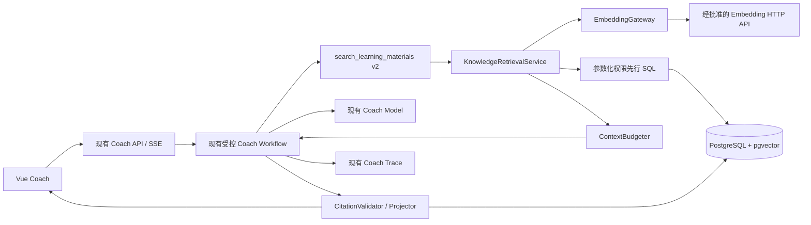
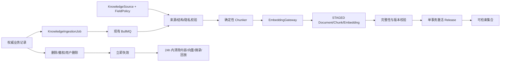

# Implementation Plan: 英语学习知识库 RAG 与来源引用

**Branch**: `002-rag-source-citations`（Spec Kit 逻辑分支；仓库未配置自动建分支钩子） | **Date**: 2026-09-08 | **Spec**: [spec.md](./spec.md)

**Input**: Feature specification from `/specs/002-rag-source-citations/spec.md`

**Plan boundary**: 本文仅定义技术方案和未来验证路径。本阶段不修改业务代码、依赖清单、锁文件、数据库、生产配置，不执行迁移，不提交、推送或部署。

## Summary

在现有 Coach 受控工作流内，将 `search_learning_materials` 的普通数据库查询替换为来源可审计、权限先行、可版本化的 PostgreSQL/pgvector RAG 检索。知识摄取、Chunk、Embedding、发布与引用解析放入现有 `@libs/learning` 领域边界；`en-ai` 继续充当 Coach、Embedding 网关和 BullMQ worker 的应用层，不新增服务或向量数据库。

首版刻意保持简单：

- 复用 PostgreSQL、Prisma、`@prisma/adapter-pg`、NestJS、BullMQ/Redis、LangGraph、共享 Zod 合同、现有 Trace/删除流程和 Vue Coach 页面。
- 通过数据库来源/字段白名单阻止无授权内容发布；尚无真实语料的例句、搭配、语法和课程正文返回 `insufficient`/不可用。
- 使用 pgvector 精确余弦近邻作为首个可复现基线；不先启用 ANN、关键词融合或 Reranker。达到数据规模或延迟证据门槛后，可在同一仓储接口后增加 HNSW，而不改变业务合同。
- Prisma 管理关系模型；`vector` 使用自定义 SQL 迁移和参数化 `$queryRaw`/`$executeRaw`，不增加 npm 依赖。
- Embedding 通过使用 Node 原生 `fetch` 的端口/适配器调用经批准的兼容 HTTP API。当前 DeepSeek 官方 API 未提供可据此假定的 Embedding 能力，因此 Provider、模型、维度、数据处理条款和价格未批准前，RAG 摄取及读取均保持关闭。
- 模型只输出服务端签发的 `citationId` 与声明关联；标题、来源和摘录均由服务端组装。历史结果在读取时重新授权并解析引用，失效来源不再返回缓存摘录。

## Technical Context

**Language/Version**: 服务端 TypeScript 5.7、Node.js `^20.19.0 || >=22.12.0`；Vue 工作区 TypeScript 6.0。

**Primary Dependencies**:

- 现有且复用：NestJS 11、Prisma 7.6、`@prisma/adapter-pg` 7.6、PostgreSQL、BullMQ 5.76、Redis/ioredis 5.10、LangChain 1.3、`@langchain/core` 1.1、LangGraph 1.2、Zod 4.3、Vue 3.5、Pinia 3、Axios、Vitest/Jest/Playwright。
- 数据库能力：部署目标需提供经批准的 pgvector 扩展；通过 SQL `CREATE EXTENSION IF NOT EXISTS vector` 启用，属于后续迁移和基础设施门禁，不在本阶段执行。
- 计划新增 npm 依赖：无。

**Storage**:

- 现有主 PostgreSQL：来源权利台账、文档、Chunk、Embedding、发布、摄取作业、私有学习摘要、引用绑定，以及原有 Coach/学习数据。
- pgvector：`KnowledgeEmbedding.embedding` 自定义 `vector` 类型；首版按当前批准 `embeddingVersion + dimensions` 精确检索。
- 现有 Redis/BullMQ：可靠摄取任务分发、Coach SSE/取消；首版不增加检索结果缓存。
- 现有 AI PostgreSQL：继续只存 LangGraph checkpoint，不复制知识库。

**Testing**:

- 服务端 Jest 30/Supertest：领域单元、合同、Prisma/pgvector 集成、访问隔离、生命周期、故障注入和迁移测试。
- 前端 Vitest/Vue Test Utils 与 Playwright：引用卡片、打开/失效、流式/历史投影和跨用户拒绝。
- 复用现有 `server/apps/ai/test/evals`，扩展版本化 RAG JSONL、固定评分量表、确定性 fake embedding 和候选 Provider live run。

**Target Platform**: 现有 `en-server`/`en-ai` Nest 应用、Vue Web 客户端和 PostgreSQL/Redis 部署；不创建新进程类型或新外部向量服务。

**Project Type**: pnpm monorepo Web 应用，包含 Vue 前端、NestJS 应用、共享包和 Nest 领域库。

**Performance Goals**:

- 所有查询记录原始候选数、权限/状态/相关性/去重后的数量、最终上下文数、检索耗时、上下文 Token 和总 Token/成本。
- 精确检索建立 Recall@K 的基准真值；P50/P95 延迟、上下文 Token 和成本目标只在固定数据集和环境测量并获批后生效。
- Top K、最低相关性、查询超时和上下文 Token 预算均由版本化批准策略限制；当前计划不编造生产数值。
- 安全门禁恒定为零容忍：跨用户泄露、Prompt Injection 越权、伪造引用、失效来源返回和 Schema 绕过均必须为 0。

**Constraints**:

- 身份只来自 `CoachExecutionContext.subjectId`；工具、Prompt、客户端和 Embedding 载荷均不得接收原始 `userId` 作为授权依据。
- 共享课程 Chunk 不按用户复制，读取时在同一参数化 SQL 内验证 `CourseRecord.isPurchased=true`。
- 来源/字段授权、Embedding Provider 条款、pgvector 可用性和 RAG 基线任一未批准时均 fail closed。
- 私有内容立即隐藏并在 24 小时内物理清除；Trace 元数据沿用 180 天，内容型诊断默认关闭且最多 7 天。
- 不修改现有普通聊天、Coach 鉴权、队列、取消、重试、预算或学习写入权限模型。
- 不在无证据前加入 ANN、混合检索、Reranker、多 Agent、MCP Server、抓取器或知识管理后台。

**Scale/Scope**:

- 第一阶段覆盖已授权词汇字段、课程/语法/例句等未来合法语料、已保存错题和最小化学习摘要；没有真实来源的类别保持不可用。
- 当前知识库规模、并发和生产延迟基线未知，因此先采用精确检索与硬上限；HNSW 只作为评测后兼容优化。
- 一次检索最多返回策略允许的 Top K（合同硬上限 20），一次 Coach 结果最多 20 个去重引用和 40 个声明关联。

## Constitution Check

*GATE: Phase 0 前检查，并在 Phase 1 后复核。*

仓库 Constitution 仍是未批准的占位模板，没有可执行的项目原则。当前有效门禁来自规格、`develop-ai-learning-feature` 和 SDD 规则。

| Gate | Pre-Phase 0 | Post-Phase 1 | Evidence |
|------|-------------|--------------|----------|
| 正确仓库与顺序 | PASS | PASS | 远端为 `cjw32/en-learning-plus`；已有经审查 `spec.md`，本轮运行官方 `setup-plan.sh --json`。 |
| 仅计划、不越权变更 | PASS | PASS | 只新增/更新 `specs/002-rag-source-citations` 文档；无依赖、代码、生产配置、数据库、提交或部署变更。 |
| 复用现有架构 | PASS | PASS | 保留 Coach 工具名、LearningModule、Prisma、BullMQ、Trace、删除流程、共享 Zod 与 Vue 页面。 |
| 来源与权利 fail closed | PASS | PASS | 来源及字段策略是发布前置条件；不把 Oxford/Collins/BNC/FRQ 字段名视为授权。 |
| 最小权限与用户隔离 | PASS | PASS | 服务端主体强制注入；单条 SQL 同时执行公共、已购课程和本人私有过滤；引用打开再次授权。 |
| 结构化输出与引用真实性 | PASS | PASS | `coach.tool.v2`/`coach.result.v2`；模型只选择本次签发 ID，服务端组装并校验声明关联。 |
| 可解释失败与回退 | PASS | PASS | `success`、`insufficient`、`failed` 分离；RAG 失败不允许事实型内容继续使用不受控材料。 |
| 生命周期与隐私 | PASS | PASS | 原子发布、失效立即隐藏、私有 24 小时清除、历史引用动态失效、Redis 回放清除。 |
| 可观测性与评测 | PASS | PASS | 复用 Coach Trace/eval，增加检索阶段计数、版本、排名、Token、成本和零容忍发布门禁。 |
| 简洁性 | PASS | PASS | 首版精确向量检索、无缓存、无 ANN/混合/Reranker、无新服务、无新 npm 依赖。 |

不存在需要 Complexity Tracking 例外的宪章冲突。未批准的数据权利、Provider、扩展和基线是发布门禁，不是被计划默认解决的事实。

## Architecture

### Runtime retrieval flow



1. Coach 依照原有确定性路由决定是否检索；普通闲聊不强制调用 RAG。
2. 工具适配器验证 `coach.tool.v2`，只把业务过滤传给 `LearningMaterialService`；认证主体仍以单独参数传递。
3. `KnowledgeRetrievalService` 合并客户端/模型的收窄过滤和服务端强制范围，生成查询向量。
4. 一个参数化 SQL 先限定当前 ACTIVE 发布、有效权利、兼容 Embedding、公共/已购课程/本人私有范围，再计算余弦距离。
5. 服务按阈值、确定性冲突、内容去重和上下文预算裁剪结果，签发本次请求范围内的 `citationId`。
6. Prompt 只接收安全结果、标准化相关性和 `citationId`，并继续使用不可信数据分隔。
7. 模型仅输出回答文本与 `groundedClaims[].citationIds`；服务端验证引用属于本请求、版本仍有效、声明文本存在于目标字段，再组装公开 Citation。
8. API/SSE 与历史读取都通过 `CoachResultProjectionService` 动态解析引用。来源失效或权限变化时返回 `unavailable`，不返回旧摘录。

### Ingestion and invalidation flow



- 可追踪更新使用数据库 `KnowledgeIngestionJob` 作为可靠 outbox；BullMQ `jobId` 使用该记录 ID，只负责分发和重试，数据库唯一约束负责幂等。
- 新内容版本完整通过后才在事务中激活；普通更新失败时旧版本继续有效。删除、到期或撤权则先立即失效，不等待新版本或异步任务。
- 当前未建立通用领域事件总线；初始回填通过现有 `server/prisma/backfills` 风格的内部脚本触发，后续业务写路径只写 outbox，不在请求事务内调用 Provider。

## Core Design Decisions

### PostgreSQL and pgvector

- 自定义迁移启用 `vector` 扩展并创建向量列；Prisma Schema 将其表示为 `Unsupported("vector")`。
- 关系 CRUD 使用 Prisma；向量写入和检索封装在一个 `PrismaKnowledgeVectorRepository` 中，只允许 tagged-template 参数化 SQL。向量数组先验证有限数、非零、维度匹配，再序列化为参数并在 SQL 中 cast 为 `vector`。
- 首版使用 exact cosine search。原始 cosine distance 转为 `relevanceScore = clamp(1 - distance / 2, 0, 1)`；只允许同一 `retrievalConfigVersion` 内比较。
- `embedding` 使用无 typmod 的 `vector`，并以 `dimensions`、`embeddingVersion` 和数据库约束保证兼容，这样 Provider 获批前不需猜测维度。未匹配当前批准维度的行不参与查询。
- 普通 B-tree 索引覆盖发布状态、权利状态、版本、分类、课程、单词、所有者与文档关系。ANN 不属于首版；若精确检索 P95 或规模基线不达标，后续用 exact 结果测量 HNSW recall 后再批准。

### Access policy

- `visibility` 保留规格要求的 `public|private`：公共与共享课程 Chunk 为 `public + userId=null`，用户错题/摘要为 `private + userId=subjectId`。
- 独立 `accessScope` 决定授权：`PUBLIC`、`OWNED_COURSE`、`PRIVATE_OWNER`。因此共享课程不会因为 `visibility=public` 就对所有用户开放。
- `OWNED_COURSE` 在向量 SQL 和引用解析 SQL 中都要求当前主体存在有效 `CourseRecord`。无权和不存在使用同一空结果/404 语义。
- 不引入 PostgreSQL RLS：当前 Prisma 连接与仓库没有请求级数据库会话身份惯例。所有读取集中到一个受测仓储查询，避免建立与现有架构不一致的第二套身份机制。

### Embedding provider and budgets

- `EmbeddingGateway` 是端口；`ConfiguredHttpEmbeddingGateway` 使用 Node 原生 `fetch` 和批准的兼容请求/响应合同，不增加 SDK。
- Provider 调用只接收最小正文；不传 JWT、原始 userId、课程购买信息、来源权利元数据或完整会话。
- 返回数量、有限数、非零向量、维度、模型和版本必须全部匹配后才能进入 STAGED。
- Provider、数据处理条款、模型、维度、价格和数据集批准均是配置门禁。缺失时摄取停止，查询返回 `failed` 或沿用 RAG 未启用模式，不产生假向量。
- 上下文裁剪复用现有 LangChain 模型的 token-count 能力，经 `CoachTokenCounter` 端口注入；不可用时使用更保守的 UTF-8 字节上界并阻止生产启用，不能静默越过预算。

### Chunking and conflict handling

- 每类来源使用确定性 Chunker，并把规范化、切分规则和长度策略纳入 `chunkingVersion`。
- Word 按词义/词性/用法单元；课程按真实章节/课时/知识点；语法按规则+适用范围+例外；练习/错题按题；摘要按主题和时间窗。
- Source adapter 可提供 `factKey`、`factValueHash`、`authorityRank`。相同 `factKey` 的不同有效值形成冲突组；版本更新优先当前内容，明确权威级可确定性消解，其他冲突不进入事实型上下文。
- 首版不使用 LLM 或 Reranker 判断冲突。无法结构化识别的文本不会被虚假宣称“已消解”，评测会单列限制。

### Citation persistence and history safety

- `citationId` 使用现有 `nanoid` 在服务端生成，并持久化绑定 `requestId + chunkId + contentVersion`；模型无法创建映射。
- `KnowledgeCitation` 保存必要的短摘录快照和哈希以做同请求校验。失效流程立即将状态改为 unavailable、清空快照，并删除受影响请求的 Redis 回放。
- `CoachRequest.finalResult`/`CoachMessage.structuredResult` 的 v2 存储形态只保留引用 ID 与声明关联，不长期复制 Citation 摘录。API/SSE 在返回时动态投影公开 `coach.result.v2`。
- 读取历史时重新检查来源状态、当前发布和当前权限；不会把旧引用自动重绑到新 Chunk。
- v1 历史结果继续由现有解析器读取；新请求只产生 v2，迁移期间使用显式 schema version 分派，不原地改写旧消息。

## Contract Strategy

Phase 1 合同位于 [contracts](./contracts/)：

- [search-learning-materials.schema.json](./contracts/search-learning-materials.schema.json)：`coach.tool.v2` 请求/响应；无 `userId`，明确 `success|insufficient|failed`、最终过滤器、结果、冲突和引用。
- [coach-result-v2.schema.json](./contracts/coach-result-v2.schema.json)：公开 `coach.result.v2`，新增可失效 Citation 与 `groundedClaims`；保持原有回答、练习、批改和学习更新形状的兼容方向。
- [coach-rag.openapi.yaml](./contracts/coach-rag.openapi.yaml)：已认证引用详情解析 API；不存在与无权均返回相同 404。

版本迁移：

1. 共享包同时导出 v1/v2 discriminated union；现有历史继续解析 v1。
2. `search_learning_materials` 适配器内部切到 v2，旧 Provider 只在 `RAG_ENABLED=false` 时保留为兼容路径。
3. RAG 模式不以未登记来源的旧查询作为故障回退；`failed` 进入安全降级。
4. Vue 先支持两版读取，再启用 v2 写入/流式结果，最后按评测批准开启 RAG。

## Observability and Evaluation

- 继续使用 `CoachStepTrace.redactedMetadata`，扩充顶层 allowlist：查询 HMAC、applied filters（不含 userId）、版本、阶段计数、排名/标准化分数、冲突/去重决策、检索耗时、上下文 Token、使用/未使用 citation ID。
- 默认不写查询正文、Chunk 正文或私有摘录；7 天诊断开关必须显式批准并经过现有敏感扫描。
- 扩展现有 eval runner，新增 RAG case/rubric/report，而非建立第二套评测框架。
- 精确检索作为 recall 基准；报告 Recall@K、Precision@K、MRR、引用正确率/覆盖率、忠实度、无来源声明率、Schema、泄露、注入、P50/P95、上下文 Token、Embedding + Coach 总成本。
- 发布报告必须绑定 source-rights snapshot、dataset、prompt、embedding、chunking、retrieval/index、schema、price 和代码版本。未批准基线时 release gate 保持关闭。

## Delivery Phases

### Phase A — Additive foundation, feature off

- 自定义 pgvector 迁移、数据实体、仓储端口、配置 Schema、版本常量和合同双读。
- 所有 RAG/摄取/私有内容开关默认关闭；验证迁移回滚与无依赖变更。

### Phase B — Rights-gated ingestion

- 建立来源/字段策略、可靠 outbox、确定性 Chunker、Embedding 网关、完整性校验和原子 release cutover。
- 仅使用人工登记且获授权的合成/项目自有样本；WordBook 字段在权利未确认前不批量摄取。

### Phase C — Retrieval, context, and Coach integration

- 实现权限先行 exact cosine 仓储、阈值/去重/冲突/context budget、`coach.tool.v2` 和 Trace。
- 更新 Prompt、模型输出 Schema、声明引用校验、v2 存储/公开投影和安全降级。

### Phase D — Citation UX and lifecycle

- Vue 引用卡片、声明关联、受控打开、历史失效展示。
- 接通更新/删除/撤权/用户删除、Redis 回放清理和 24 小时 purge。

### Phase E — Evaluation and gated rollout

- 扩展确定性、集成、安全、浏览器和 RAG eval；先测 exact baseline，再决定是否需要 HNSW。
- `off → shadow → enabled` 分阶段；shadow 结果不进 Prompt/前端。生产启用需要用户另行授权并满足所有门禁。

## Project Structure

### Documentation (this feature)

```text
specs/002-rag-source-citations/
├── plan.md
├── research.md
├── data-model.md
├── quickstart.md
├── contracts/
│   ├── coach-rag.openapi.yaml
│   ├── coach-result-v2.schema.json
│   └── search-learning-materials.schema.json
└── tasks.md                         # 仅由后续 $speckit-tasks 生成；本轮不创建
```

### Planned source changes (future Implement phase)

```text
packages/common/coach/
├── result.schemas.ts                # v1/v2 结果与 Citation/claim links
├── tool.schemas.ts                  # coach.tool.v2 RAG 合同
└── generate-contracts.ts            # 生成并校验版本化工件

server/prisma/
├── schema.prisma                    # 来源、文档、Chunk、Release、作业、引用、摘要
├── migrations/<timestamp>_rag_knowledge/
│   └── migration.sql                # CREATE EXTENSION + vector/custom constraints
└── backfills/knowledge-index.ts     # 显式授权后才运行的幂等回填

server/libs/learning/src/knowledge/
├── domain/                          # 状态、版本、来源策略和纯规则
├── ingestion/                       # adapters、Chunker、发布/失效服务
├── retrieval/                       # query policy、vector repository、context budget
├── citations/                       # 签发、校验、解析和失效
├── summaries/                       # 已保存事实 → 最小化私有摘要
└── privacy/                         # 用户/来源删除编排

server/apps/ai/src/coach/
├── tools/search-learning-materials.tool.ts
├── prompts/answer.prompt.ts
├── workflow/coach-runtime.workflow.ts
├── workflow/coach-model.gateway.ts
├── workflow/final-result.validator.ts
├── observability/coach-redaction.ts
└── api/                             # 历史结果投影与 citation resolver endpoint

server/apps/ai/src/knowledge/
├── embedding/                       # native-fetch Provider adapter + fake
└── queue/                           # outbox dispatcher + BullMQ processor

server/apps/ai/test/
├── contract/
├── integration/
├── security/
└── evals/                           # 复用现有 runner/fixtures/rubrics/reports

apps/web/src/
├── apis/coach/                      # v1/v2 parser + citation detail API
├── stores/coach.ts
└── views/Coach/components/          # CitationCard / claim association / unavailable state
```

**Structure Decision**: 维持现有 monorepo 和“AI 应用适配器 → Learning 领域服务 → Prisma”方向。知识生命周期属于 `@libs/learning`，Provider HTTP 与 BullMQ 属于 `en-ai` 基础设施；共享合同仍位于 `@en/common`，Vue 只消费公开投影。

## Migration, Rollback, and Rollout

1. 后续经授权后先在一次 additive migration 中启用 pgvector 并创建新表/约束；不修改已有业务字段语义。
2. 部署代码时所有 RAG flags 关闭，验证旧 Coach v1 与非 AI 回归。
3. 登记来源权利及字段白名单，使用合成/授权内容做幂等回填；STAGED 内容不可检索。
4. 完成 embedding、完整性和安全测试后激活 release；shadow 模式比较但不影响回答。
5. 完成并批准专项基线后才允许 v2 结果进入 Prompt，再逐步启用 Citation UI。
6. 回滚优先关闭 RAG 读取并恢复 legacy tool path；数据库表保持 additive。禁止把失效/撤权内容作为回滚数据重新启用。
7. 若后续选择 HNSW，必须单独记录 pgvector 版本、索引参数、exact-vs-ANN recall 和过滤后足量结果证据；合同不变。

## Risks and Explicit Release Blockers

| ID | Risk/blocker | Mitigation and gate |
|----|--------------|---------------------|
| RB-001 | 运行 PostgreSQL 未提供 pgvector | 在可处置环境验证扩展版本、迁移、备份恢复；未通过不得启用。 |
| RB-002 | WordBook 字段无来源/许可证台账 | 逐字段白名单；未确认字段不摄取，品牌字段名不作为证据。 |
| RB-003 | 课程/语法/例句/搭配正文当前不存在 | 类别保持 unavailable/insufficient；不生成伪语料。 |
| RB-004 | 课程公共子集未确认 | 采用现有 `OWNED_COURSE` 更严格边界；只有后续明确授权才能新增 `PUBLIC` 子集。 |
| RB-005 | Embedding Provider、维度、条款和价格未批准 | Provider 门禁关闭；不复用 DeepSeek chat 凭证作假设，不发送私有内容。 |
| RB-006 | 无 RAG 质量/延迟/成本基线 | exact baseline + 固定数据集先测量；目标获批前发布门禁关闭。 |
| RB-007 | 历史 JSON/SSE 缓存泄露失效摘录 | v2 存储只保留 ID；动态投影；失效清空 Citation 摘录并清除相关 Redis stream。 |
| RB-008 | exact search 随规模变慢 | 记录 P95 与 explain evidence；有数据后再评估 HNSW，不提前增加复杂度。 |

## Complexity Tracking

无宪章违规或额外复杂度豁免。Content Release、可靠 outbox 和动态 Citation 投影分别直接解决“不可混合发布”“可靠删除/重试”和“历史失效不泄露”三个规格硬约束，不能由简单缓存或 JSON 快照安全替代。
