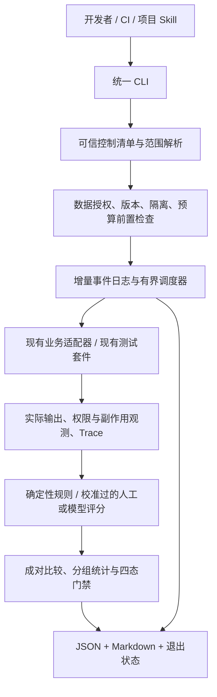

# Implementation Plan: 统一 AI 评测与质量门禁

**Branch**: `codex/english-learning-mcp`（实际 Git 分支；setup-plan 返回的逻辑功能标识为 `005-unified-ai-evaluation`） | **Date**: 2026-09-14 | **Spec**: [spec.md](./spec.md)

**Input**: Feature specification from `specs/005-unified-ai-evaluation/spec.md`；用户已确认该规格并要求进入 Plan。

**Status**: Plan complete — 可供后续 Tasks 使用；当前只交付设计，未实施或运行评测。

## Summary

在现有 `server/apps/ai/test/evals` 中增加一个独立、版本化的 TypeScript 评测编排层，以同一 CLI 供开发者、CI 和后续 `run-ai-evaluation` Skill 调用。统一案例清单、执行状态、预算、版本比较和报告；通过适配器调用现有 Coach/RAG/发音/MCP 业务入口与测试，不复制业务规则。结果采用 JSON + Markdown，增量事件记录负责中断恢复与审计，不新增评测数据库、服务或 UI。

保留原模块的严格安全与默认关闭策略；旧 Mock、合成描述、手填观测仅作为测试替身或评测器自测。完整资格检查必须有真实业务/Provider、人工校准、授权音频、独立验证和实际 MCP 客户端证据。未具备条件时输出 `INCOMPLETE`，不会靠适配旧报告制造通过。

## Technical Context

**Language/Version**: 服务端 TypeScript `^5.7.3`，现有 ES2023/NodeNext 编译设置；计划运行环境为现有 Node 24 系列，实际 Node/pnpm/锁文件版本纳入运行快照，不升级依赖。

**Primary Dependencies**: 复用 Node 内置 fs/path/crypto/child_process/util、已有 tsx、ts-node、tsconfig-paths、Jest 30/ts-jest、NestJS 11 测试能力、Supertest、`@en/common` 的 Zod 4、Prisma/pgvector、ioredis/BullMQ、MinIO、已安装 MCP SDK。CLI 编排用 tsx；需要 Nest 装饰器元数据的业务 worker 用现有 ts-node + tsconfig-paths，规则套件使用现有 Jest transform，不假设 tsx 能生成装饰器元数据。无新增 npm 包或系统依赖。

**Storage**: 版本控制中只放合成案例、元数据与政策引用；运行产物写入调用者指定的独立目录，以不可变 manifest、追加 JSONL 事件、逐案结果、JSON/Markdown 汇总保存。测试副作用只在已验证的临时 PostgreSQL/Redis/MinIO 中使用现有业务表与命名空间；不增加生产表或迁移。

**Testing**: Jest/ts-jest 做核心规则与调度器验证；现有合同、安全、业务与数据库测试复用；Supertest/MCP SDK 驱动真实服务边界；既有 Playwright/Vitest 承担业务回归。真实评测由同一 CLI 在显式批准且可计费的隔离环境运行。

**Target Platform**: Linux CI 和 macOS 本地。MCP 产品客户端由实际安装环境执行；Inspector 仅承担声明的协议能力。没有客户端或音频工具链时明确缺依赖，不自动下载安装。

**Project Type**: pnpm monorepo 内部开发 CLI + 业务评测适配器 + 项目级 Skill；非生产服务、非评测 SaaS。

**Performance Goals**: 继承 spec 的已有指标及分母：发音合法请求成功率 ≥99%、同音频分数最大差异 ≤5、匹配人工口音组异常差距 ≤5、批准条件下上传完成到终态 P95 ≤15 秒；其他质量/费用/延迟仍由有来源的批准政策提供。调度默认串行，快速检查零付费；不新增或假定质量 SLO。

**Constraints**: 每轮有界并发、超时、重复与预算；权限/幂等使用实际边界观测；没有价格上界禁止付费；保留首次失败；必需缺证据不能通过。未经明确授权不新增依赖、不改生产配置、不推送或部署。本轮不编码、不生成 tasks.md、不创建 Skill、不运行付费评测。

**Scale/Scope**: 四模块；复用 Coach 60 条、RAG 四组 20/9/6/7 条、发音 3 条合成描述、MCP 主集 18 条及附加专项样本，补足正式验证覆盖。起步采用单协调进程、有界 worker；不用分布式评测队列。案例数量不是已满足真实质量样本量的证明。

## Constitution Check

项目宪章仍为未填写模板；跳过宪章示例门禁。以下约束来自明确用户指令、已确认规格及 develop-ai-learning-feature，而非新增宪章。

| Gate | Phase 0 前 | Phase 1 后 | 依据 |
| --- | --- | --- | --- |
| 目标仓库与工作区 | PASS | PASS | remote 已核对；原有未跟踪内容保留；原项目不作修改目标。 |
| SDD 顺序与当前范围 | PASS | PASS | 005 Specify 已完成，本轮仅设计文档和接口契约，无 Tasks/实现。 |
| 复用架构和依赖 | PASS | PASS | 仅现有 TypeScript/Node 工具链与现有业务；不引入评测框架或 Provider SDK。 |
| 主体隔离、写操作与证据 | PASS | PASS | 独立测试凭证/实例验证，调用业务权限/事务路径，不能用 Mock 证明真实写入正确性。 |
| 真实质量与成本 | PASS | PASS | 全轮预算含裁判与在途请求；缺真实/金标/批准证据为 INCOMPLETE；安全失败优先。 |
| 基线与规则不可暗改 | PASS | PASS | control manifest 与候选分离，批准事实由可信控制上下文提供；运行不更新政策/基线。 |
| 生产与交付边界 | PASS | PASS | 不修改生产模块默认配置、生产部署或远程保护；后续 CI/Skill 仍在功能交付中。 |

**Design gate result**: PASS。没有未解决的架构选择；真实基线、音频权利、模型/价格、保留政策和环境批准是 spec DEP-001–DEP-007 的运行门禁，未因此假装已经解决，也不阻塞设计。若未来只能靠新增依赖或缩减范围实现，应先提出明确变更，不能自行绕过。

## Project Structure

### Documentation (this feature)

```text
specs/005-unified-ai-evaluation/
├── spec.md                     # 已确认需求，保持不变
├── evidence-inventory.md        # Specify 事实盘点，保持不变
├── checklists/requirements.md   # Specify 检查，保持不变
├── plan.md
├── research.md
├── data-model.md
├── quickstart.md
├── traceability.md
└── contracts/
    ├── cli.md
    ├── report.md
    └── ci.md
```

`tasks.md` 由后续 Tasks 阶段生成，本轮不创建。

### Source Code (repository root)

以下都是后续拟变更位置，本轮不创建这些源码或配置。

```text
server/apps/ai/test/evals/
├── run.ts, report.ts, release-gate.ts, fixtures/, rubrics/   # 现有，保持兼容
├── pronunciation/, mcp/                                    # 现有可复用组件
└── unified/
    ├── cli.ts, contracts/, core/                           # 入口、严格校验、调度/比较/报告
    ├── adapters/                                          # coach/rag/pronunciation/mcp/jest
    ├── workers/                                           # 隔离业务组合与调用边界
    ├── catalog/                                           # 旧案例映射、变更影响和必需覆盖
    ├── policies/                                          # 有来源的规则及未批准状态
    └── fixtures/, tests/                                  # 新合成/可信性参照样本
.agents/skills/run-ai-evaluation/SKILL.md                    # 后续交付，当前不创建
.github/workflows/ai-evaluation.yml                         # 后续 CI 工作流，当前不创建
```

**Structure Decision**: CLI 入口放在已有评测位置，通过现有 `pnpm --filter @en/server exec` 执行，无需增加 workspace、根 package 脚本或生产依赖。现有 `tsconfig.build.json` 没有排除全部辅助评测源，因此核心代码也必须能通过现有构建；不导入到生产 Module，不以改生产构建配置规避错误。测试编译使用现有工具链。

## Architecture and Runtime Flow



### A1. 控制数据与候选代码分离

- 协调器从受信任 control root 读取案例目录、范围政策、基线登记、批准记录和适配器版本。CI 固定为维护者控制的提交；候选不能通过改自身测试列表/阈值或报告让缺失案例通过。普通本地工作区可作为开发控制源，但报告注明 trust=local，不推定有 CI/发布权威。
- 用户传入候选 checkout/配置路径，不由评测命令切换分支、拉取代码或自动建立 Git worktree。双版本比较可用已批准历史 baseline bundle，或显式提供第二个 checkout 同轮重测；旧版本缺少 unified 源码时由当前控制版本的 worker 加载它的业务入口。版本合同不兼容且无已审核映射时 INCOMPLETE。
- 固定 tracked/staged/unstaged 和纳入候选的非敏感 untracked 源码指纹、锁文件及运行输入；配置只保存脱敏投影和内容指纹，不保存密钥。候选快照缺失、执行期间发生变化则本轮不可作为确定版本资格证据。
- 哈希用于完整性，不充当授权。批准者/时间/依据必须来自受信任的登记；JSON 中单独填写 approved=true 不足以批准。CI 与维护者审查建立信任，不建立新的签名服务。

### A2. 隔离 worker 与实际业务复用

| 适配器 | 复用路径和实际观察 | 模式与限制 |
| --- | --- | --- |
| Coach | `CoachRuntimeWorkflowService`、`CoachWorkflowExecutor`、现有工具和 `ConfiguredCoachStructuredModel`；记录意图、工具参数/路径、最终结果、材料及 Trace。权限/写入专项通过现有 controller/guard/service 和测试数据库。 | mock 使用确定响应但执行真实工作流；live 使用既有模型适配器。旧 mockResult 不作为实际候选执行。 |
| RAG | `RagLearningMaterialSearchService`、`PrismaKnowledgeVectorRepository`、现有 ingestion/chunk/Embedding/citation/context 业务；检索指标读取真正返回的 chunk 和声明引用。 | fake Embedding 明确 mock；live 走已批准 HTTP Embedding 及实际测试索引；问答忠实度另走 Coach grounded answer。只读检索和摄取/生命周期分别标记。 |
| 发音 | `PronunciationAssessmentService`、音频 inspector、MinIO storage、Azure adapter、Provider executor、对齐/置信度和学习 finalize。 | 测试组合显式注入已存在的真实实现；不修改生产 Module 的 Unavailable 默认绑定。需要获准可用的 ffmpeg/ffprobe、私有测试存储和人工音频；缺少即 INCOMPLETE。 |
| MCP | 现有 HTTP protocol/auth/capability handlers、四只读工具、create_quiz、submit_answer、三个 Prompt；SDK/Supertest 复用已有协议检查，实际授权、确认与写入通过业务路径观察。 | SDK harness 不冒充 Codex/Claude Desktop/VS Code/Inspector；真实产品客户端证据按下述会话契约归并。 |
| 既有测试 | 显式登记的 Jest 文件与用例名称、config、需求和案例 ID；复用 contract/security/integration/evals/E2E。 | 解析逐测试状态、skip 和实际命中集合；子进程退出 0 不等于全部必需用例通过。不扫描并执行任意候选提供的命令。 |

worker 只组合实际服务、端口和授权测试依赖，不复制出题、检索、批改或持久化规则。需要 Nest 元数据的运行在 ts-node/Jest 对应 worker 中，不在 CLI 进程中直接载入全部 AppModule。

现有 `SharedModule` 会读取 cwd 下 `.env` 并注册支付、邮件等无关服务。统一 worker 使用不含 `.env` 的运行目录、白名单环境变量，在任何业务 import 之前设置专用测试配置；用测试组合覆盖外部依赖并禁止启动无关应用。不得认为 `NODE_ENV=test` 或 URL 含 test 就足够隔离。资源配置要求精确主机/库/角色/bucket/Redis namespace 允许清单、测试环境指纹和有效期；专用凭证不能访问生产实例。只读身份探测在创建测试资源前完成，无法验证则拒绝。

### A3. MCP 实际客户端执行

四客户端沿用 004 矩阵。统一入口为每个需要人工客户端操作的执行项创建有截止时间的 run/case/session challenge、给出合成任务与允许能力，等待获授权操作者在实际客户端执行；实际服务端 Trace 与客户端脱敏转录需绑定该 challenge、版本、时间、主体/客户端别名及候选指纹。

通过 `attach-client-evidence` 将当轮证据交给协调器校验，人工步骤属于同一计划清单，不是复制旧 report.pass。Inspector 无模型时工具选择不适用，协议仍必需；有模型客户端缺少真实选择过程则未完成。已结束轮的迟到证据只能进入关联补测新轮，不能静默重写首次失败/未完成。

客户端模型费用也属于预算：只有客户端/Provider 具备可核验的调用/Token/费用上界且能限制本轮用量时才启动；不能控制或计量的订阅/远端客户端保持未完成，不把费用写成零。此设计不开发新 MCP 客户端、不安装 Inspector、不替用户更改客户端生产配置。实际操作步骤及证据格式见 [CLI](./contracts/cli.md) 和 [Report](./contracts/report.md)。

### A4. 预算、取消与持久化

- 单协调器串行处理额度预留消息；worker 在每个业务 Provider/Embedding/judge 调用前请求 reservation。原有业务预算仍然生效，全轮预算是额外上限，不替代原限流/幂等规则。
- 可用金额 = 总预算 − 已结算金额 − 所有在途及受理不明 reservation。价格版本与输入/输出/音频时长上界给出保守费用；不能证明上界就不发起。测量时记录 estimate/actual/unknown，内部预算不能把 unknown 当作零。外部价格漂移超出批准上界时停止后续调用并记录异常。
- 调度项保存 reservation 后才派发；各 worker 有稳定 callId，重复请求同一预留不重复扣账。采样重复、自动重试与基线重跑均计费，裁判单独记用量且汇总入总额。
- SIGINT/SIGTERM、整轮期限、预算停止进入 STOPPING；不再派发/续发调用，传递 AbortSignal，保留在途接受状态。停止宽限到期杀死隔离进程及其受控子进程，不能据本地 kill 声称远端已取消或测试事务已回滚。
- 在第一项执行前写 manifest；worker 不直接写最终报告，由协调器追加序号事件并检查关键记录可持久化。终态先写事件再原子替换结果；部分尾记录损坏按中断恢复，不跳过损坏后声称 complete。SIGKILL 无法运行 finally，因此下一次 `recover` 根据日志、业务对账及资源清单产出 INCOMPLETE 恢复报告，不自动重发未知受理调用。
- 每个测试资源登记 owner/run/case 和删除状态；cleanup 限于登记资源，采用原业务删除/补偿路径和测试实例生命周期。清理失败时保存残留并阻止资格通过。租约过期清理由隔离环境既有调度设施调用 `cleanup`/`purge`，不依赖终端进程永久存活。

### A5. 基线、评分与统计

- 案例目录以 module + stable legacy ID 形成全局身份，附带原文件/hash、原规格验收、风险、split 和来源授权，保留旧样本格式；新增独立验证样本和人工金标分开管理。
- RAG gold 优先使用 sourceId + sourceVersion + evidence span/meaning ID；由两侧实际 chunk 到语义证据映射计算召回。切分导致无法映射时重标/重跑批准基线，不能把本次预期结果直接变成召回观测。
- 主观 judge 复用现有模型传输能力但用评测专属身份、固定 Prompt/schema 和独立人工校准；输入候选以不可信数据包装，输出 strict Schema、分值范围、理由/证据引用。缺人工校准为 INCOMPLETE，合法分歧为 REVIEW，安全断言不交给 judge。
- 比较先检查 identical 条件与 intentionalDifferences。同数据/评分语义、隔离状态和缓存条件下允许指定模型/Prompt/Provider 不同；缺模型实际版本只记录可获得信息和供应方身份保证，若无法保证本门禁可比性则 INCOMPLETE。
- 采用每案例聚合后成对差异；多次运行保持原次数和失败率，不能扩大独立 N。波动包括原始重复值、均值/中位数、最小/最大/标准差；需推断时使用版本化 paired cluster bootstrap，在案例或预定义同源组级抽样，记录 seed、迭代数、置信水平与政策最小有效量，不引入统计包。小样本/政策缺项为 INCOMPLETE；证据齐全但区间不能支持明确结论为 REVIEW，不宣称微小改善。
- 统计参数、容忍范围与 minN 属于可信政策；本 Plan 不新增质量阈值或擅设通过界限。可复用原发音固定数值与量表，但保留原指标分母及时间区间。
- 基线批准由独立维护任务创建 append-only baseline 登记，绑定目标运行 hash、批准事实与适用条件；本 CLI 不提供自动 approve/promote/update-threshold 开关。允许 measurement 采集未批准候选观测，只有采集完成状态，不据此声称质量资格通过，详见 CLI。

### A6. 门禁、报告与 CI

逐项终态与整轮执行完成度分开；四态优先级 `FAIL > INCOMPLETE > REVIEW > PASS`。失败但重跑成功的首次记录不变；聚合按预先固定规则处理全部尝试。可选检查在执行前固定，任何已证实零容忍违规仍阻断。完整性来自计划集合与实际逐项结果对账，不能只依据有效样本平均值。

机器结果和可读报告来自同一经校验聚合对象；退出码固定 0/1/2/3 分别对应 PASS/FAIL/INCOMPLETE/REVIEW。工具进程异常退出未产生报告时，CI 外层也必须保留“没有有效结果”的未完成记录。完整字段、原因码、统计公式见 [Report contract](./contracts/report.md)。

CI 选 GitHub Actions（仓库在 GitHub，当前无工作流），只设计一份后续工作流：PR/push 的无秘密快速检查，维护者显式触发的可信真实运行，always 汇总/保存证据。可信控制版本独立于候选；不使用 pull_request_target 执行不可信代码，不将 fork 的脚本/缓存送入有秘密的 job。检查绑定、environment secrets/保护和远程保留权限属于独立配置事项。本轮不写 YAML 或改后台设置；详见 [CI contract](./contracts/ci.md)。

### A7. 隐私与 Skill

运行目录本地权限 0700、文件 0600，不在仓库中默认保存实际运行内容。可发布合成摘要与受限证据分开；报告不保存 JWT/密钥/连接串、原始系统 Prompt 或音频地址，Schema 采用 allowlist，配合原 redaction/sensitive scan。错误输出必须先清洗，不能原样透传 Provider/Jest stderr。

保存政策采用每类 policyId/ttl/deletionDeadline/accessRoles，不推定新内容授权。合成案例可版本保留；Coach/RAG 元数据 180 天、显式诊断 ≤7 天与音频等来源限制保持上限；新增 CI 产物/人工复核/回放政策未获批准时不收集受限内容。到期/撤权删除覆盖工作区、私有对象、CI 受限副本和派生材料；由资源清单追踪删除状态，历史基线标记 evidence_deleted，不为复现重建已撤销数据。

后续 Skill 内容包括仓库校验、变更识别、`inspect` 前置检查、实际 `run`、报告/schema/hash 核对、SDD 关联和失败解释；说明四态/退出码、费用未知、历史报告和人工步骤。默认不改源码、数据集、评分或基线；建议与自动修复分开。Skill 与直接 CLI 的同配置验证列入 quickstart，当前不创建 Skill。

## Verification and Delivery Boundaries

[quickstart.md](./quickstart.md) 定义后续可执行验收；[traceability.md](./traceability.md) 将 52 个 FR 和 18 个 SC 映射到设计与验证。重点验证已知好/坏业务输入、真实测试事务越权/重复写入、模式造假、评分器失败、空集合、分组回退、重试保留、版本不匹配、预算竞态与中断恢复。

只复用存在的测试环境；缺 PostgreSQL/Redis/MinIO/ffmpeg/客户端/数据/预算就产出 INCOMPLETE。不会安装补齐，也不将旧未完成浏览器矩阵写成通过。工作流与 CLI 的实现成功仍不等于完整功能验收，必须满足 spec 最后一段的真实四模块证据要求。

## Plan Workflow Record

- setup-plan 已执行，FEATURE_SPEC/IMPL_PLAN/SPECS_DIR 均解析到 005。BRANCH 输出是 Spec Kit 逻辑功能名；实际 Git 分支保持不变。
- Phase 0：复用 001–004 既有设计与 Specify 证据盘点；新增编排、隔离、比较、客户端证据与 CI 决策记录在 [research.md](./research.md)。
- Phase 1：新增数据模型、CLI/报告/CI 契约、验证指南和追溯表；不改变业务 API/表/合同，不生成完整源码或测试实现。
- 前后均核对 `.specify/extensions.yml` 不存在，无 before_plan/after_plan hook。
- 不需要 Complexity Tracking 例外：没有违反已确认规则的架构选型。

### 2026-09-15 Implement 续接

继续执行既有 T030–T105，不重置既有进度。优先打通实际可执行链：full 收集已可运行的四模块业务/安全回归，并把缺少的真实质量前提逐项保留；与 quick 的数据格式检查分别计量。补充只读历史报告比较、分组和独立样本统计、并发/重试完整记录、独立验证与恢复报告。复用现有测试组合及依赖，既有模型、音频和客户端实际质量要求保持不变；规则通过不能升级为资格通过。真实样本/人工校准、定价/预算、独立客户端和远程 CI 的实际验收仍需要对应证据，缺项记录为 INCOMPLETE。

用户确认没有人工样本，本轮先合成验证。增加 `synthetic` profile（全量离线业务目录，quick 保持小范围，full 保留外部依赖）；该 profile 与 quick 共用零付费、环境白名单和有界子进程。命令提供根目录入口与独立运行目录，历史比较是只读开发检查，不是基线批准。
