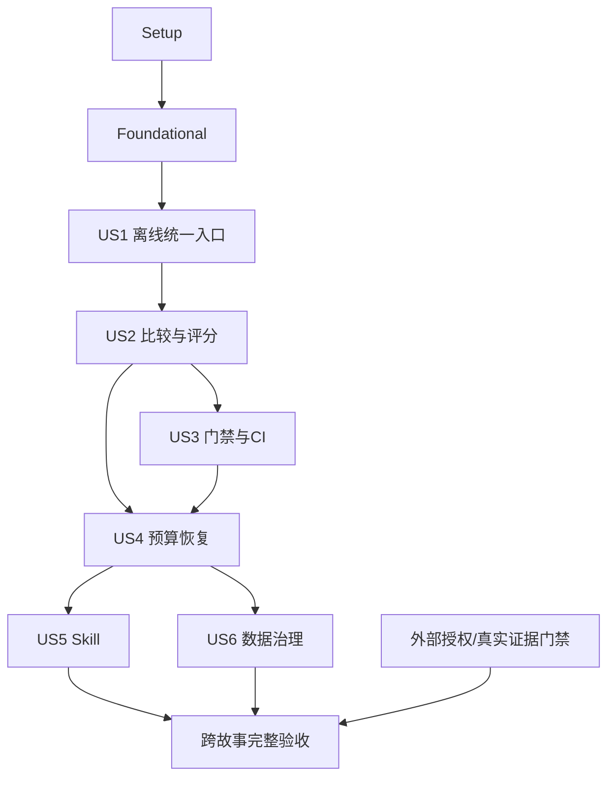

---

**实现进度（2026-09-14）**：已验证完成 T001–T029（29/105）。T030–T040 存在部分实现，但依赖与完整验收尚未满足，保持未勾选；T041–T105 待实施。详见 [本轮证据](evidence/us1-quick-run.md)。

description: "Dependency-ordered tasks for unified AI evaluation and quality gates"
---

# Tasks: 统一 AI 评测与质量门禁

**Input**: `specs/005-unified-ai-evaluation/` 中已确认的 [spec](./spec.md)、[plan](./plan.md)、[research](./research.md)、[data-model](./data-model.md)、[contracts](./contracts/cli.md)、[quickstart](./quickstart.md) 和 [追溯表](./traceability.md)。

**Created**: 2026-09-14  
**Status**: Implement 进行中；仅在相应验证与证据完成后勾选任务。  
**Branch**: 实际 Git 分支 `codex/english-learning-mcp`；功能目录 005 不要求分支改名。

**Tests**: 用户和规格明确要求测试与AI评测。各故事测试先于实现：测试任务完成需观察目标行为缺失的 RED，后续实现验证必须 GREEN；RED 不是功能通过。

**Organization**: 按六个用户故事排序。下面的 Phase 1–9 是 Tasks 内部执行分组，不增加 Specify → Plan → Tasks → Implement 之外的 SDD 阶段。

## Format and Path Conventions

- 每项格式为 `- [ ] Tnnn [P?] [USn?]`，并包含文件、FR关联、依赖和验证。所有路径相对仓库根 `/Users/woofeel/Downloads/en-learning-plus`；正文给出的新路径是后续拟交付文件，不表示已存在。
- `[P]` 仅表示列明前提完成后可与同批不同文件任务并行；不是现在授权启动Agent或运行任务。共享文件集成任务串行，依赖优先于编号/段落。
- JEST 后的 `apps/...` 表示从仓库根执行 `pnpm --filter @en/server exec jest --runInBand <该路径>`。使用独立 E2E 配置的既有套件由目录显式登记配置，不能盲用默认Jest漏测。每项验证还须保存真实退出码/计数，不能只有“运行测试”。
- V-001–V-008 为 quickstart 验证场景。所有执行证据先遵循 T003 的格式；受限原始资料置于已批准的私有产物位置，仓库 evidence Markdown 只保存安全摘要、引用和hash。
- 通用完成条件：实现任务的聚焦测试通过、实际文件符合对应设计、证据可追溯；执行验收任务必须真实执行并满足验收，发现失败/缺前提保持未勾选并记录原因。不能仅创建报告文件就标完成。
- 复用原模块阈值/量表/数据和依赖；不授权新增依赖、改变生产配置、自动批准/更新基线、推送或部署。源码改动只在未来明确的 Implement 任务授权后执行。
- `.specify/memory/constitution.md` 未填写，示例不是约束。before_tasks/after_tasks 配置不存在，均跳过。

## External Execution Gates

| Gate | 必需证据与阻断行为 |
| --- | --- |
| G-01 | 样本/音频授权、独立验证与人工标注/校准、阈值/最小样本量/基线批准记录。没有证据只可做合成自测，不捏造人工金标或批准。 |
| G-02 | 明确付费任务授权、Provider/模型/地域/价格/全轮上界预算（含基线、Embedding、裁判与客户端）。本轮任务生成不是收费授权。 |
| G-03 | 已批准的隔离测试资源/专用凭证/身份探测、原生音频工具和清理机制；缺工具不自动安装，不使用生产环境。 |
| G-04 | 实际客户端及模型组合、协议能力、授权操作人、同轮challenge/独立Trace和可约束费用；SDK替身不替代真实矩阵。 |
| G-05 | 运行/Agent/CI环境批准、产物ACL/保留/删除/副本治理，以及必要的远程配置授权。无配置不声称远程门禁已生效。 |

这些门禁对应 spec DEP-001–DEP-007，按任务阶段检查所需输入；准备样本和首次测量不以前述任务自身将产出的金标或新基线批准作为先决条件。正式资格比较仍要求全部适用批准齐备。依赖未满足时继续可独立完成的无付费实现/测试；受限任务保持未完成，最终资格不可通过。不通过放宽门禁解决外部阻断。

## Phase 1: Setup（仓库与验证边界）
**Goal**: 确认现有输入、工具链和不可变基准，不初始化第二个项目。
**Independent Test**: 记录当前源文件/锁文件/配置指纹；读取实际依赖，建立可追溯证据目录，不运行付费服务。

### Implementation / Verification Tasks
- [X] T001 核对 remote、当前分支、工作区及已确认文档；记录受保护文件和原有跳过项，保留用户修改。文件：`specs/005-unified-ai-evaluation/evidence/implementation-start.md`。需求：FR-005, FR-021, FR-052；依赖：无；验证：核对 origin、HEAD、dirty 与源/锁文件/生产配置 hash；与 evidence-inventory.md 对照，不读取秘密值。
- [X] T002 验证现有 tsx/ts-node/tsconfig-paths/Jest/Zod 与 NodeNext/装饰器元数据组合的可执行性，只记录已有能力及缺项。文件：`specs/005-unified-ai-evaluation/evidence/toolchain-check.md`。需求：FR-001, FR-005；依赖：T001；验证：以现有安装执行无网络版本/编译加载探针；确认 CLI 不加载 Nest，worker 用现有编译器；缺依赖记 BLOCKED 不安装。
- [X] T003 [P] 建立逐任务证据约定：命令、退出码、模式、版本、计数、报告 hash、环境、授权、失败与跳过原因。文件：`specs/005-unified-ai-evaluation/evidence/README.md`。需求：FR-035, FR-037, FR-039；依赖：T001；验证：审查示例没有虚构 PASS；测试 RED、GREEN、未执行与真实评测证据可分辨。
- [X] T004 [P] 建立 G-01–G-05 外部前提登记，列数据/人工校准、Provider预算、隔离资源、真实客户端和产物治理的证据要求。文件：`specs/005-unified-ai-evaluation/evidence/prerequisites.md`。需求：FR-007, FR-018, FR-030, FR-041, FR-047, FR-049；依赖：T001；验证：每项有来源 DEP、责任者角色、状态和恢复条件；未批准保持 CLOSED，不能用本文创建批准。

**Checkpoint**: 只在本组所需任务真实完成且证据齐备时确认对应范围；不推导未执行范围通过。

## Phase 2: Foundational（所有故事的阻断前置）
**Goal**: 实现公共严格合同、隔离、事件记录及零付费运行所需最小控制能力。
**Independent Test**: 公共参照测试证明坏配置/错误主体/空集合/预算上界/报告故障不会通过；所有故事从同一基础运行。
**Blocking**: 本组完成前不进入用户故事。真实执行仍需额外G门禁，不由基础完成自动放行。

### Tests（先写并验证目标RED）
- [X] T005 [P] 编写案例、请求、运行/尝试、版本、账本、报告的严格 Schema 与非法值参照测试。文件：`server/apps/ai/test/evals/unified/tests/schemas.spec.ts`。需求：FR-009, FR-021, FR-028, FR-036, FR-038；依赖：T002、T003、T004；验证：JEST `apps/ai/test/evals/unified/tests/schemas.spec.ts`：先记录目标行为未实现的 RED；不接受语法错误或错误测试配置造成的假 RED。
- [X] T006 [P] 编写可信控制、候选篡改批准、路径逃逸、环境泄漏、生产目标拒绝与读前隔离测试。文件：`server/apps/ai/test/evals/unified/tests/control-isolation.spec.ts`。需求：FR-027, FR-041, FR-047, FR-048；依赖：T002、T003、T004；验证：JEST `apps/ai/test/evals/unified/tests/control-isolation.spec.ts`：先记录目标行为未实现的 RED；不接受语法错误或错误测试配置造成的假 RED。
- [X] T007 [P] 编写计划集合、单终态、序号链、写前记录、截断和落盘失败测试。文件：`server/apps/ai/test/evals/unified/tests/journal-state.spec.ts`。需求：FR-028, FR-031, FR-035, FR-036, FR-039；依赖：T002、T003、T004；验证：JEST `apps/ai/test/evals/unified/tests/journal-state.spec.ts`：先记录目标行为未实现的 RED；不接受语法错误或错误测试配置造成的假 RED。
- [X] T008 [P] 编写预留/结算幂等、未知费用、非法预算与 quick 零外部调用测试。文件：`server/apps/ai/test/evals/unified/tests/budget-admission.spec.ts`。需求：FR-004, FR-033, FR-038；依赖：T002、T003、T004；验证：JEST `apps/ai/test/evals/unified/tests/budget-admission.spec.ts`：先记录目标行为未实现的 RED；不接受语法错误或错误测试配置造成的假 RED。

### Implementation / Verification Tasks
- [X] T009 定义 E1–E9 的严格版本化对象与模式/状态/原因枚举，拒绝未知字段、非有限分值与无理由空值。文件：`server/apps/ai/test/evals/unified/contracts/case.schema.ts`、`server/apps/ai/test/evals/unified/contracts/run.schema.ts`、`server/apps/ai/test/evals/unified/contracts/evidence.schema.ts`、`server/apps/ai/test/evals/unified/contracts/report.schema.ts`。需求：FR-006, FR-009, FR-021, FR-028, FR-036, FR-038；依赖：T005；验证：JEST `apps/ai/test/evals/unified/tests/schemas.spec.ts` 通过；校验与 data-model.md/Report contract 对齐，公共 Zod 从已有包导入。
- [X] T010 [P] 实现可信 control manifest 与批准引用加载、hash/允许根校验，拒绝候选自声明 approved 与任意脚本。文件：`server/apps/ai/test/evals/unified/core/control-loader.ts`。需求：FR-021, FR-023, FR-027, FR-041；依赖：T009、T006；验证：JEST `apps/ai/test/evals/unified/tests/control-isolation.spec.ts` 通过。
- [X] T011 [P] 实现白名单环境和无 .env cwd、精确资源允许清单/租约/身份探测；业务 import 前完成隔离，保留原生产默认关闭。文件：`server/apps/ai/test/evals/unified/workers/environment-guard.ts`、`server/apps/ai/test/evals/unified/workers/test-resource-lease.ts`。需求：FR-007, FR-047, FR-048；依赖：T009、T006；验证：JEST `apps/ai/test/evals/unified/tests/control-isolation.spec.ts` 通过；专用角色不能访问生产；不能只靠 localhost/test 字符串；缺实际环境在集成任务验证，不以替身宣称安全。
- [X] T012 实现候选/控制 checkout 与 commit、脏改动、非敏感 untracked、锁文件指纹，禁止改分支或自动 fetch。文件：`server/apps/ai/test/evals/unified/core/version-snapshot.ts`。需求：FR-021, FR-039；依赖：T010、T006；验证：JEST `apps/ai/test/evals/unified/tests/control-isolation.spec.ts` 通过；候选运行中变化、秘密文件被纳入快照均拒绝或未完成。
- [X] T013 [P] 实现 manifest 首写、递增事件与 reservation 派发前持久化、终态原子写及可检测截断。文件：`server/apps/ai/test/evals/unified/core/event-journal.ts`、`server/apps/ai/test/evals/unified/core/run-state.ts`。需求：FR-033, FR-035, FR-036, FR-039；依赖：T009、T007；验证：JEST `apps/ai/test/evals/unified/tests/journal-state.spec.ts` 通过。
- [X] T014 实现单协调器费用预留/结算/受理不明账本和 quick 零费用准入；未知价格/上界不发起调用。文件：`server/apps/ai/test/evals/unified/core/budget-ledger.ts`。需求：FR-004, FR-033, FR-038；依赖：T009、T013、T008；验证：JEST `apps/ai/test/evals/unified/tests/budget-admission.spec.ts` 通过；记录币种/价格版本与原业务预算并存，不改阈值。
- [X] T015 实现 runRoot 内路径/权限0700和0600、allowlist脱敏、敏感扫描、安全stderr与产物原子写；拒绝越界及覆盖原run。文件：`server/apps/ai/test/evals/unified/core/artifact-store.ts`、`server/apps/ai/test/evals/unified/core/redaction.ts`。需求：FR-035, FR-037, FR-039, FR-048, FR-049；依赖：T009、T013、T006；验证：JEST `apps/ai/test/evals/unified/tests/control-isolation.spec.ts` 通过；复用原 redaction；受限产物无批准政策不保存。
- [X] T016 [P] 实现通用四态归并与计数对账，缺结果/零项/非法分值未完成，FAIL 优先并保留次级原因。文件：`server/apps/ai/test/evals/unified/core/gate.ts`、`server/apps/ai/test/evals/unified/core/counts.ts`。需求：FR-028, FR-031, FR-032, FR-036；依赖：T009、T007；验证：JEST `apps/ai/test/evals/unified/tests/journal-state.spec.ts` 通过。

### Tests（先写并验证目标RED）
- [X] T017 [P] 编写无shell worker协议、白名单变量、限时终止、恶意消息/任意端口与未登记调用拒绝测试。文件：`server/apps/ai/test/evals/unified/tests/worker-boundary.spec.ts`。需求：FR-004, FR-006, FR-033, FR-047, FR-048；依赖：T011、T014、T015；验证：JEST `apps/ai/test/evals/unified/tests/worker-boundary.spec.ts`：先记录目标行为未实现的 RED；不接受语法错误或错误测试配置造成的假 RED。

### Implementation / Verification Tasks
- [X] T018 建立受控 worker 消息契约、tsx协调与ts-node/Jest执行选择；所有外部调用需协调器预留，保留调用和取消身份。文件：`server/apps/ai/test/evals/unified/contracts/worker.schema.ts`、`server/apps/ai/test/evals/unified/workers/worker-host.ts`。需求：FR-004, FR-006, FR-033, FR-037, FR-047；依赖：T010、T012、T016、T017；验证：JEST `apps/ai/test/evals/unified/tests/worker-boundary.spec.ts` 通过；协调器不启动整个生产 AppModule；不复制业务规则。
- [X] T019 执行基础套件并记录冻结的公共接口、quick 默认和 live 禁止条件，确认可开始故事任务。文件：`specs/005-unified-ai-evaluation/evidence/foundation.md`。需求：FR-001, FR-004, FR-028, FR-047；依赖：T018、T014、T015、T016、T012、T013；验证：JEST unified/tests 基础文件通过；现有 server 构建通过；公共 Schema、worker、预算、artifact 互通且真实调用次数为0。

**Checkpoint**: 基础接口与离线保护通过后可进入故事任务。

## Phase 3: User Story 1 — 一次运行获得可信回归结果（P1，MVP）
**Goal**: 实现四模块按范围运行和可信的逐案报告；MVP 仅限定离线 quick，不宣称真实质量验收。
**Independent Test**: V-001/V-002：四模块和all各一次执行，已知好坏样本正确归类；非法筛选/缺凭证/模式伪造均不通过。

### Tests（先写并验证目标RED）
- [X] T020 [P] [US1] 编写 CLI 选项/模式、AND-OR筛选、未知/零命中、变更扩展、quick与qualification区别的合同测试。文件：`server/apps/ai/test/evals/unified/tests/scope-cli.contract.spec.ts`。需求：FR-001, FR-002, FR-003, FR-007, FR-008, FR-031；依赖：T019；验证：JEST `apps/ai/test/evals/unified/tests/scope-cli.contract.spec.ts`：先记录目标行为未实现的 RED；不接受语法错误或错误测试配置造成的假 RED。
- [X] T021 [P] [US1] 编写四业务适配器的实际调用/返回观测、替身标记与禁止expected作actual的测试。文件：`server/apps/ai/test/evals/unified/tests/module-adapters.spec.ts`。需求：FR-005, FR-006, FR-012, FR-013, FR-014, FR-015；依赖：T019；验证：JEST `apps/ai/test/evals/unified/tests/module-adapters.spec.ts`：先记录目标行为未实现的 RED；不接受语法错误或错误测试配置造成的假 RED。
- [X] T022 [P] [US1] 编写 JSON/Markdown 同源、逐项计数、跳过/崩溃、未知Token/成本和报告失败合同测试。文件：`server/apps/ai/test/evals/unified/tests/report.contract.spec.ts`。需求：FR-035, FR-036, FR-037, FR-038, FR-039；依赖：T019；验证：JEST `apps/ai/test/evals/unified/tests/report.contract.spec.ts`：先记录目标行为未实现的 RED；不接受语法错误或错误测试配置造成的假 RED。

### Implementation / Verification Tasks
- [X] T023 [P] [US1] 映射旧60条样本、六量表、工具路径与Coach v1/v2兼容要求，保留原ID和需求。文件：`server/apps/ai/test/evals/unified/catalog/coach.catalog.ts`。需求：FR-005, FR-009, FR-011；依赖：T019、T021；验证：JEST `apps/ai/test/evals/unified/tests/module-adapters.spec.ts` 通过；缺元数据逐项标未完成，不推定授权或Schema兼容。
- [X] T024 [P] [US1] 映射20/9/6/7条RAG数据及检索/生命周期/降级/个性化场景，标记预期构造观测仅自测。文件：`server/apps/ai/test/evals/unified/catalog/rag.catalog.ts`。需求：FR-005, FR-009, FR-011；依赖：T019、T021；验证：JEST `apps/ai/test/evals/unified/tests/module-adapters.spec.ts` 通过；缺元数据逐项标未完成，不推定授权或Schema兼容。
- [X] T025 [P] [US1] 映射3条合成描述和版本/授权/音频要求，明确无真实金标不能作为质量样本。文件：`server/apps/ai/test/evals/unified/catalog/pronunciation.catalog.ts`。需求：FR-005, FR-009, FR-011；依赖：T019、T021；验证：JEST `apps/ai/test/evals/unified/tests/module-adapters.spec.ts` 通过；缺元数据逐项标未完成，不推定授权或Schema兼容。
- [X] T026 [P] [US1] 映射18条主集及建题/Prompt专项与实际客户端要求，区别SDK模拟和真实客户端。文件：`server/apps/ai/test/evals/unified/catalog/mcp.catalog.ts`。需求：FR-005, FR-009, FR-011；依赖：T019、T021；验证：JEST `apps/ai/test/evals/unified/tests/module-adapters.spec.ts` 通过；缺元数据逐项标未完成，不推定授权或Schema兼容。
- [X] T027 [US1] 合并模块目录，固定必需场景/正反覆盖、ID去重、标签与来源hash，保持development默认。文件：`server/apps/ai/test/evals/unified/catalog/catalog.ts`、`server/apps/ai/test/evals/unified/catalog/coverage.v1.json`。需求：FR-002, FR-008, FR-009, FR-011；依赖：T023、T024、T025、T026、T020；验证：JEST `apps/ai/test/evals/unified/tests/scope-cli.contract.spec.ts` 通过。
- [X] T028 [US1] 实现变更路径到模块/跨模块影响映射及冻结scope；资格必需集不由用户过滤缩减。文件：`server/apps/ai/test/evals/unified/core/scope.ts`、`server/apps/ai/test/evals/unified/catalog/change-impact.v1.json`。需求：FR-002, FR-003, FR-008, FR-031；依赖：T027、T020；验证：JEST `apps/ai/test/evals/unified/tests/scope-cli.contract.spec.ts` 通过。
- [X] T029 [P] [US1] 复用显式登记的现有Jest/E2E config与用例，解析逐测试结果/skip/todo/零命中而非只读退出码。文件：`server/apps/ai/test/evals/unified/adapters/jest.adapter.ts`、`server/apps/ai/test/evals/unified/catalog/jest-tests.v1.json`。需求：FR-005, FR-006, FR-031, FR-036；依赖：T027、T021；验证：JEST `apps/ai/test/evals/unified/tests/module-adapters.spec.ts` 通过。
- [ ] T030 [P] [US1] 调用候选CoachRuntimeWorkflowService/Executor与既有工具、真实或受控模型；记录意图、参数、Schema和Trace。文件：`server/apps/ai/test/evals/unified/adapters/coach.adapter.ts`、`server/apps/ai/test/evals/unified/workers/coach.worker.ts`。需求：FR-005, FR-006, FR-007, FR-012, FR-037；依赖：T027、T021；验证：JEST `apps/ai/test/evals/unified/tests/module-adapters.spec.ts` 通过；不调用旧mockResult作为业务输出；模型路径仍有预算/授权门禁。
- [ ] T031 [P] [US1] 调用现有摄取/Embedding/向量检索/引用/context及Coach grounded answer；从实际检索/声明获取观测。文件：`server/apps/ai/test/evals/unified/adapters/rag.adapter.ts`、`server/apps/ai/test/evals/unified/workers/rag.worker.ts`。需求：FR-005, FR-006, FR-007, FR-013, FR-037；依赖：T027、T021；验证：JEST `apps/ai/test/evals/unified/tests/module-adapters.spec.ts` 通过；fake Embedding标mock，维护权利和版本过滤。
- [ ] T032 [P] [US1] 在评测组合接入已有Azure/音频inspector/私有MinIO/评测finalize，保留生产Unavailable绑定。文件：`server/apps/ai/test/evals/unified/adapters/pronunciation.adapter.ts`、`server/apps/ai/test/evals/unified/workers/pronunciation.worker.ts`。需求：FR-005, FR-006, FR-007, FR-008, FR-014；依赖：T027、T021；验证：JEST `apps/ai/test/evals/unified/tests/module-adapters.spec.ts` 通过；依赖/音频/隐私/模型条件不足返回INCOMPLETE，不安装工具链。
- [ ] T033 [P] [US1] 复用现有MCP协议/auth/Resource/Tool/Prompt业务和SDK；记录能力/参数/确认/幂等观测并标客户端来源。文件：`server/apps/ai/test/evals/unified/adapters/mcp.adapter.ts`、`server/apps/ai/test/evals/unified/workers/mcp.worker.ts`。需求：FR-005, FR-006, FR-007, FR-015, FR-037；依赖：T027、T021；验证：JEST `apps/ai/test/evals/unified/tests/module-adapters.spec.ts` 通过；SDK不以产品客户端名称冒充真实验证。

### Tests（先写并验证目标RED）
- [ ] T034 [P] [US1] 编写回放来源/hash/Schema/主体绑定、秘密泄漏和missing cassette测试。文件：`server/apps/ai/test/evals/unified/tests/record-replay.spec.ts`。需求：FR-006, FR-007, FR-048, FR-049；依赖：T019；验证：JEST `apps/ai/test/evals/unified/tests/record-replay.spec.ts`：先记录目标行为未实现的 RED；不接受语法错误或错误测试配置造成的假 RED。

### Implementation / Verification Tasks
- [ ] T035 [US1] 实现经授权录制证据到cassette的最小化保存及回放，固定主体/版本/模式，不回退为live。文件：`server/apps/ai/test/evals/unified/adapters/replay.adapter.ts`、`server/apps/ai/test/evals/unified/contracts/replay.schema.ts`。需求：FR-006, FR-007, FR-048, FR-049；依赖：T027、T034；验证：JEST `apps/ai/test/evals/unified/tests/record-replay.spec.ts` 通过；仅批准政策允许的录制；默认quick使用合成cassette。
- [ ] T036 [US1] 关联run/item/attempt到现有各模块Trace、工具和副作用安全引用，捕获Provider/Embedding/裁判用量来源。文件：`server/apps/ai/test/evals/unified/core/trace-linker.ts`、`server/apps/ai/test/evals/unified/core/observation-collector.ts`。需求：FR-006, FR-021, FR-037, FR-038；依赖：T030、T031、T032、T033、T022；验证：JEST `apps/ai/test/evals/unified/tests/report.contract.spec.ts` 通过。
- [ ] T037 [US1] 从校验后的统一对象生成JSON和Markdown，完整呈现scope/计数/失败证据/用量和复现条件。文件：`server/apps/ai/test/evals/unified/core/report.ts`、`server/apps/ai/test/evals/unified/core/report-markdown.ts`。需求：FR-035, FR-036, FR-037, FR-038, FR-039；依赖：T036、T016、T022；验证：JEST `apps/ai/test/evals/unified/tests/report.contract.spec.ts` 通过。
- [ ] T038 [US1] 实现冻结计划逐项派发及结果收集，接通四adapter/Jest/replay与预算、artifact，full缺条件先拒绝。文件：`server/apps/ai/test/evals/unified/core/run-coordinator.ts`。需求：FR-001, FR-003, FR-004, FR-007, FR-031；依赖：T028、T029、T035、T036、T037、T020；验证：JEST `apps/ai/test/evals/unified/tests/scope-cli.contract.spec.ts` 通过；初版默认串行，任何选中item都有终态/原因。
- [ ] T039 [US1] 实现inspect/run/verify与严格参数解析，遵循0/1/2/3门禁退出；inspect等操作成功不冒充评测通过。文件：`server/apps/ai/test/evals/unified/cli.ts`、`server/apps/ai/test/evals/unified/core/cli-options.ts`。需求：FR-001, FR-002, FR-003, FR-028, FR-039, FR-042；依赖：T038、T037、T020；验证：JEST `apps/ai/test/evals/unified/tests/scope-cli.contract.spec.ts` 通过；measurement无资格证据为2；无自动更新基线/安装/任意脚本选项。
- [ ] T040 [US1] 补齐已知好/坏quick参照与CLI端到端检查，记录四模块、all、筛选和缺真实前提结果。文件：`server/apps/ai/test/evals/unified/tests/quick-run.integration.spec.ts`、`server/apps/ai/test/evals/unified/fixtures/assurance-cases.jsonl`、`specs/005-unified-ai-evaluation/evidence/us1-quick-run.md`。需求：FR-001, FR-005, FR-006, FR-031, FR-050, FR-051；依赖：T039；验证：JEST `apps/ai/test/evals/unified/tests/quick-run.integration.spec.ts`；V-001/V-002符合scope；真实Provider调用0，不把已识别坏候选当通过。

**Checkpoint**: 只在本组所需任务真实完成且证据齐备时确认对应范围；不推导未执行范围通过。

## Phase 4: User Story 2 — 比较一次AI变更的质量与代价（P1）
**Goal**: 实现可追溯基线、实际指标、人工校准与随机性比较，不自动批准基线。
**Independent Test**: V-004/V-005：同条件两个候选可比；数据/评分变更不可直接比；局部分组回退、缺人工金标和小样本不产生虚假改进。

### Tests（先写并验证目标RED）
- [ ] T041 [P] [US2] 编写双checkout/历史bundle、dirty快照、模型有意差异、dataset/gold/评分变化及过期批准测试。文件：`server/apps/ai/test/evals/unified/tests/baseline-comparison.spec.ts`。需求：FR-021, FR-022, FR-023, FR-027；依赖：T040；验证：JEST `apps/ai/test/evals/unified/tests/baseline-comparison.spec.ts`：先记录目标行为未实现的 RED；不接受语法错误或错误测试配置造成的假 RED。
- [ ] T042 [P] [US2] 编写指标手算、零分母、重叠标签、独立N、重复/cluster bootstrap与分组回退测试。文件：`server/apps/ai/test/evals/unified/tests/metrics-statistics.spec.ts`。需求：FR-024, FR-025, FR-026, FR-051；依赖：T040；验证：JEST `apps/ai/test/evals/unified/tests/metrics-statistics.spec.ts`：先记录目标行为未实现的 RED；不接受语法错误或错误测试配置造成的假 RED。
- [ ] T043 [P] [US2] 编写固定量表/模型版本/理由证据、裁判注入/非法分数、校准缺失和分歧仲裁测试。文件：`server/apps/ai/test/evals/unified/tests/judge-calibration.spec.ts`。需求：FR-016, FR-017, FR-018, FR-019, FR-020；依赖：T040；验证：JEST `apps/ai/test/evals/unified/tests/judge-calibration.spec.ts`：先记录目标行为未实现的 RED；不接受语法错误或错误测试配置造成的假 RED。

### Implementation / Verification Tasks
- [ ] T044 [P] [US2] 采集实际Prompt/hash、工具Schema、Provider可得版本、RAG/发音/客户端及运行条件，明确unknown/N-A。文件：`server/apps/ai/test/evals/unified/core/module-version-snapshot.ts`。需求：FR-021, FR-022；依赖：T040、T041；验证：JEST `apps/ai/test/evals/unified/tests/baseline-comparison.spec.ts` 通过。
- [ ] T045 [P] [US2] 实现可信baseline登记读取、批准hash/范围与撤权校验，历史导入保留来源，拒绝文件名approved推定批准。文件：`server/apps/ai/test/evals/unified/core/baseline-store.ts`。需求：FR-023, FR-027, FR-039；依赖：T040、T041；验证：JEST `apps/ai/test/evals/unified/tests/baseline-comparison.spec.ts` 通过。
- [ ] T046 [US2] 实现两侧相同案例执行或批准bundle复用，检查intentionalDifferences和可比条件；不支持旧合同则未完成。文件：`server/apps/ai/test/evals/unified/core/paired-run.ts`、`server/apps/ai/test/evals/unified/core/comparability.ts`。需求：FR-021, FR-022, FR-023；依赖：T044、T045、T041；验证：JEST `apps/ai/test/evals/unified/tests/baseline-comparison.spec.ts` 通过。
- [ ] T047 [P] [US2] 实现RAG source/version/语义证据到两侧chunk映射，去重计算相关性和引用支持所需实际证据。文件：`server/apps/ai/test/evals/unified/core/rag-gold-mapping.ts`。需求：FR-013, FR-022, FR-025；依赖：T040、T042；验证：JEST `apps/ai/test/evals/unified/tests/metrics-statistics.spec.ts` 通过；切分变化不能直接复制expected；映射失效提示重标/重跑。
- [ ] T048 [US2] 接入既有Coach/RAG/发音/MCP指标，固定分子分母/单位/方向、人工音频前提和Provider支持维度。文件：`server/apps/ai/test/evals/unified/core/module-metrics.ts`。需求：FR-012, FR-013, FR-014, FR-015, FR-025；依赖：T047、T042；验证：JEST `apps/ai/test/evals/unified/tests/metrics-statistics.spec.ts` 通过；发音WER不截断、Provider内耗时不替代上传后P95；未知费用不填0。
- [ ] T049 [US2] 实现模块/等级/题型/风险/口音/客户端分组及总体去重，保留未知属性和排除理由。文件：`server/apps/ai/test/evals/unified/core/group-metrics.ts`。需求：FR-024, FR-025；依赖：T048、T042；验证：JEST `apps/ai/test/evals/unified/tests/metrics-statistics.spec.ts` 通过。
- [ ] T050 [US2] 实现按案例/同源cluster成对统计与固定seed/bootstrap；重复不增加独立N，参数从批准政策读取。文件：`server/apps/ai/test/evals/unified/core/paired-statistics.ts`。需求：FR-026, FR-051；依赖：T049、T042；验证：JEST `apps/ai/test/evals/unified/tests/metrics-statistics.spec.ts` 通过；手算/固定seed可重复；缺minN政策为INCOMPLETE，合法不确定为REVIEW。
- [ ] T051 [P] [US2] 复用现有各模块规则和量表并固定内容hash、版本/证据需求；安全检查只用实际规则观测。文件：`server/apps/ai/test/evals/unified/core/evaluator-registry.ts`、`server/apps/ai/test/evals/unified/catalog/evaluators.v1.json`。需求：FR-016, FR-017, FR-019；依赖：T040、T043；验证：JEST `apps/ai/test/evals/unified/tests/judge-calibration.spec.ts` 通过。
- [ ] T052 [US2] 实现人工标注/模型校准记录与适用范围校验、独立验证和追加复核记录，不赋予裁判批准权限。文件：`server/apps/ai/test/evals/unified/core/calibration-store.ts`、`server/apps/ai/test/evals/unified/core/review-store.ts`。需求：FR-018, FR-020；依赖：T051、T043；验证：JEST `apps/ai/test/evals/unified/tests/judge-calibration.spec.ts` 通过。
- [ ] T053 [US2] 通过既有模型传输创建独立评测裁判，隔离不可信候选、严格输出校验并记录模型/Prompt/理由/证据/费用。文件：`server/apps/ai/test/evals/unified/adapters/judge.adapter.ts`。需求：FR-017, FR-018, FR-019, FR-020, FR-033, FR-038；依赖：T052、T036、T014、T043；验证：JEST `apps/ai/test/evals/unified/tests/judge-calibration.spec.ts` 通过；缺人工校准不能产生正式质量分；模型评分不能证明鉴权或写入。
- [ ] T054 [US2] 定义独立验证/人工标注/校准输入的非敏感manifest与来源/暴露约束，已有可见样本保留development。文件：`server/apps/ai/test/evals/unified/catalog/validation.manifest.json`、`server/apps/ai/test/evals/unified/catalog/calibration.manifest.json`。需求：FR-009, FR-010, FR-011, FR-018；依赖：T052；验证：校验manifest严格Schema、近重复组不跨split、授权人工/音频缺项为pending；不编造人工数据或足够样本数。
- [ ] T055 [US2] 接入双版本、规则/人工/模型评分、分组/随机性到统一run和报告；measurement不自动变成批准基线。文件：`server/apps/ai/test/evals/unified/core/run-coordinator.ts`、`server/apps/ai/test/evals/unified/core/report.ts`。需求：FR-017, FR-021, FR-022, FR-023, FR-024, FR-025, FR-026, FR-027；依赖：T046、T050、T053、T054、T041；验证：JEST `apps/ai/test/evals/unified/tests/baseline-comparison.spec.ts` 通过；同轮两侧成本进入一个账本，普通运行政策hash不变。
- [ ] T056 [US2] 执行无付费成对/评分系统可信性矩阵并输出版本、分组、波动和待测量证据。文件：`server/apps/ai/test/evals/unified/tests/comparison.integration.spec.ts`、`specs/005-unified-ai-evaluation/evidence/us2-comparison.md`。需求：FR-018, FR-020, FR-022, FR-026, FR-051；依赖：T055；验证：JEST `apps/ai/test/evals/unified/tests/comparison.integration.spec.ts`；V-004及模拟V-005，真实模型/音频/客户端证据明确未执行。

**Checkpoint**: 只在本组所需任务真实完成且证据齐备时确认对应范围；不推导未执行范围通过。

## Phase 5: User Story 3 — 审查和CI阻止错误结论（P1）
**Goal**: 接入源自规格的完整门禁政策、真实权限/副作用断言及可信CI汇总。
**Independent Test**: V-003/V-008：已证实安全失败即FAIL；缺必需检查/报告INCOMPLETE；有效分歧REVIEW；不可信PR无秘密。

### Tests（先写并验证目标RED）
- [ ] T057 [P] [US3] 编写原模块严格阻断继承、分组/可选安全失败、基线缺失、服务故障和四态优先级测试。文件：`server/apps/ai/test/evals/unified/tests/quality-gates.spec.ts`。需求：FR-028, FR-029, FR-030, FR-031, FR-032；依赖：T056；验证：JEST `apps/ai/test/evals/unified/tests/quality-gates.spec.ts`：先记录目标行为未实现的 RED；不接受语法错误或错误测试配置造成的假 RED。
- [ ] T058 [P] [US3] 编写CI缺job/缺报告、被篡改候选/政策、4种退出结果、artifact失败和quick不替资格的合同测试。文件：`server/apps/ai/test/evals/unified/tests/ci.contract.spec.ts`。需求：FR-040, FR-041, FR-042, FR-043；依赖：T056；验证：JEST `apps/ai/test/evals/unified/tests/ci.contract.spec.ts`：先记录目标行为未实现的 RED；不接受语法错误或错误测试配置造成的假 RED。
- [ ] T059 [US3] 新增实际业务权限/确认/事务回归：跨用户、未授权/重复写入、凭证与虚假引用参照；不得仅手填失败标记。文件：`server/apps/ai/test/evals/unified/tests/side-effects.integration.spec.ts`。需求：FR-016, FR-029, FR-047, FR-050；依赖：T056；验证：JEST `apps/ai/test/evals/unified/tests/side-effects.integration.spec.ts`：先记录目标行为未实现的 RED；不接受语法错误或错误测试配置造成的假 RED。

### Implementation / Verification Tasks
- [ ] T060 [US3] 映射原规格零容忍及既有发音99%/5分/15秒的原分母规则；未测普通阈值/minN保持pending，不改变旧基线。文件：`server/apps/ai/test/evals/unified/policies/gates.v1.json`、`server/apps/ai/test/evals/unified/core/gate-policy.ts`。需求：FR-029, FR-030；依赖：T056、T057；验证：JEST `apps/ai/test/evals/unified/tests/quality-gates.spec.ts` 通过；每项阈值有原SC与批准来源，不从当前成绩倒推。
- [ ] T061 [US3] 扩展通用门禁为资格要求、充分样本/可比性/校准、分组回退和多原因归并；修复verify以独立重算。文件：`server/apps/ai/test/evals/unified/core/gate.ts`、`server/apps/ai/test/evals/unified/core/verify.ts`。需求：FR-028, FR-029, FR-030, FR-031, FR-032, FR-039；依赖：T060、T057；验证：JEST `apps/ai/test/evals/unified/tests/quality-gates.spec.ts` 通过。
- [ ] T062 [US3] 将既有auth/confirmation/业务事务测试路径接入观察器，采集专用资源前后变化及身份边界；确认拒绝与违规区分。文件：`server/apps/ai/test/evals/unified/core/side-effect-observer.ts`。需求：FR-016, FR-029, FR-037, FR-047, FR-050；依赖：T061、T059；验证：JEST `apps/ai/test/evals/unified/tests/side-effects.integration.spec.ts` 通过；无隔离DB时实测部分保持INCOMPLETE，不以DDL字符串或Mock替代。
- [ ] T063 [P] [US3] 实现CI可信期望检查清单与独立聚合入口，校验版本/hash/退出状态和missing结果，支持安全摘要及上传失败原因。文件：`server/apps/ai/test/evals/unified/core/ci-summary.ts`。需求：FR-040, FR-041, FR-042；依赖：T061、T058；验证：JEST `apps/ai/test/evals/unified/tests/ci.contract.spec.ts` 通过。
- [ ] T064 [US3] 编写计划中的GitHub工作流：无秘密PR/push快速检查、显式可信full、最小权限/精确版本、最终对账和安全产物；不配置远程保护。文件：`.github/workflows/ai-evaluation.yml`。需求：FR-040, FR-041, FR-042, FR-043；依赖：T063；验证：JEST `apps/ai/test/evals/unified/tests/ci.contract.spec.ts`；审查无pull_request_target执行不可信代码、无秘密跨job/缓存、非零不可被最后命令洗白；新增工具/Action依赖须另有授权。
- [ ] T065 [US3] 记录远程分支检查绑定、维护者/环境保护、凭证/预算/保留及runner前提的独立配置清单，缺配置不声称已阻止远程合并。文件：`specs/005-unified-ai-evaluation/evidence/ci-configuration.md`。需求：FR-040, FR-041, FR-043, FR-049；依赖：T064；验证：逐项给待批准/待验证状态、责任者与证据位置；本任务不修改GitHub后台或生产配置。
- [ ] T066 [US3] 执行四态CI模拟与无付费实际隔离权限/事务验证，保留机器状态及源业务证据；缺环境部分保持未完成。文件：`specs/005-unified-ai-evaluation/evidence/us3-gates-ci.md`。需求：FR-028, FR-029, FR-031, FR-041, FR-042, FR-050；依赖：T062、T064、T065；验证：JEST `apps/ai/test/evals/unified/tests/quality-gates.spec.ts`、JEST `apps/ai/test/evals/unified/tests/ci.contract.spec.ts`、JEST `apps/ai/test/evals/unified/tests/side-effects.integration.spec.ts`；V-003/V-008完整对账。 前提：G-03（实际数据库验证）；无该前提先完成离线测试并保留未完成项。

**Checkpoint**: 只在本组所需任务真实完成且证据齐备时确认对应范围；不推导未执行范围通过。

## Phase 6: User Story 4 — 有限预算、失败定位和恢复（P1）
**Goal**: 完善跨Provider/裁判/客户端预算、取消/超时/崩溃恢复、部分报告及全部重试证据。
**Independent Test**: V-006：模拟并发争用最后额度、已受理不可撤销、worker崩溃及落盘故障；停止后无新调用，首次失败仍可查。

### Tests（先写并验证目标RED）
- [ ] T067 [P] [US4] 编写两侧/Embedding/裁判/客户端共享上界、并发预留、未知受理、价格漂移及结算重放测试。文件：`server/apps/ai/test/evals/unified/tests/budget-concurrency.spec.ts`。需求：FR-004, FR-033, FR-038, FR-052；依赖：T061、T063；验证：JEST `apps/ai/test/evals/unified/tests/budget-concurrency.spec.ts`：先记录目标行为未实现的 RED；不接受语法错误或错误测试配置造成的假 RED。
- [ ] T068 [P] [US4] 编写SIGINT/TERM、worker崩溃/强杀、尾日志损坏、部分结果、不能撤销写入和重试保留测试。文件：`server/apps/ai/test/evals/unified/tests/cancellation-recovery.spec.ts`。需求：FR-033, FR-034, FR-035, FR-039, FR-052；依赖：T061、T063；验证：JEST `apps/ai/test/evals/unified/tests/cancellation-recovery.spec.ts`：先记录目标行为未实现的 RED；不接受语法错误或错误测试配置造成的假 RED。
- [ ] T069 [P] [US4] 编写MCP challenge/版本/案例/真实客户端绑定、转录与独立Trace、截止时间、重复/迟交和费用不可控拒绝测试。文件：`server/apps/ai/test/evals/unified/tests/client-session.contract.spec.ts`。需求：FR-015, FR-033, FR-034, FR-037, FR-038；依赖：T061、T063；验证：JEST `apps/ai/test/evals/unified/tests/client-session.contract.spec.ts`：先记录目标行为未实现的 RED；不接受语法错误或错误测试配置造成的假 RED。

### Implementation / Verification Tasks
- [ ] T070 [US4] 完善跨worker两侧/裁判/语音/客户端的持久化额度准入、原业务上限并存与未知占用；禁止重启自动释放。文件：`server/apps/ai/test/evals/unified/core/budget-ledger.ts`、`server/apps/ai/test/evals/unified/core/call-meter.ts`。需求：FR-004, FR-033, FR-038；依赖：T014、T067；验证：JEST `apps/ai/test/evals/unified/tests/budget-concurrency.spec.ts` 通过；实际费用与估算/潜在费用分列，原报表汇总不得重复计费。
- [ ] T071 [US4] 实现run/case期限、并发上限、STOPPING、AbortSignal、受控子进程组终止与停止后派发禁止。文件：`server/apps/ai/test/evals/unified/core/stop-controller.ts`、`server/apps/ai/test/evals/unified/workers/worker-host.ts`。需求：FR-004, FR-033, FR-052；依赖：T070、T068；验证：JEST `apps/ai/test/evals/unified/tests/cancellation-recovery.spec.ts` 通过；本地kill不能视为远端撤销或数据库回滚。
- [ ] T072 [US4] 实现repeatIndex与retryIndex/parentAttempt关系，遵守业务安全重试；首败不可覆盖且未知受理不自动重发。文件：`server/apps/ai/test/evals/unified/core/attempt-lineage.ts`。需求：FR-026, FR-034, FR-039；依赖：T071、T068；验证：JEST `apps/ai/test/evals/unified/tests/cancellation-recovery.spec.ts` 通过。
- [ ] T073 [US4] 实现journal校验、业务终态对账、独立恢复记录/报告修订；不能伪装首次运行已及时完成。文件：`server/apps/ai/test/evals/unified/core/recovery.ts`。需求：FR-033, FR-034, FR-035, FR-039；依赖：T072、T068；验证：JEST `apps/ai/test/evals/unified/tests/cancellation-recovery.spec.ts` 通过。
- [ ] T074 [US4] 实现lease登记测试资源的有界清理/补偿、残留与宽限过期对账，拒绝任意或生产删除。文件：`server/apps/ai/test/evals/unified/core/resource-cleanup.ts`。需求：FR-033, FR-047, FR-052；依赖：T073、T068；验证：JEST `apps/ai/test/evals/unified/tests/cancellation-recovery.spec.ts` 通过；cleanup成功不改变原质量结论；崩溃租约交既有批准清理设施。
- [ ] T075 [US4] 建立同轮MCP实际客户端challenge、人工操作等待、Trace/转录校验及收费上界；Inspector仅按实际能力计分。文件：`server/apps/ai/test/evals/unified/core/client-sessions.ts`、`server/apps/ai/test/evals/unified/contracts/client-evidence.schema.ts`。需求：FR-015, FR-033, FR-037, FR-038；依赖：T070、T071、T069；验证：JEST `apps/ai/test/evals/unified/tests/client-session.contract.spec.ts` 通过；费用不能约束的客户端不启动付费，不复制一个产品结果到另一个。
- [ ] T076 [US4] 接入recover/cleanup/attach-client-evidence命令和安全操作状态；迟到证据须关联新轮，终态报告不可覆盖。文件：`server/apps/ai/test/evals/unified/cli.ts`、`server/apps/ai/test/evals/unified/core/run-coordinator.ts`。需求：FR-015, FR-033, FR-034, FR-035, FR-037, FR-047；依赖：T074、T075、T069；验证：JEST `apps/ai/test/evals/unified/tests/client-session.contract.spec.ts` 通过；JEST `apps/ai/test/evals/unified/tests/cancellation-recovery.spec.ts` 通过；操作0不等同gate PASS。
- [ ] T077 [US4] 完善每阶段Token/时延/币种价格依据、实际/估算/潜在费用、重复差异和取消残留的统一报告。文件：`server/apps/ai/test/evals/unified/core/report.ts`、`server/apps/ai/test/evals/unified/core/report-markdown.ts`。需求：FR-026, FR-035, FR-037, FR-038；依赖：T076、T072、T067；验证：JEST `apps/ai/test/evals/unified/tests/budget-concurrency.spec.ts` 通过；JEST `apps/ai/test/evals/unified/tests/report.contract.spec.ts`；unknown不能填0，公开摘要不泄漏内容。
- [ ] T078 [US4] 执行调度/中断/预算/恢复故障矩阵，记录部分报告、调用时序、首次结果与测试清理事实。文件：`specs/005-unified-ai-evaluation/evidence/us4-budget-recovery.md`。需求：FR-004, FR-033, FR-034, FR-035, FR-038, FR-052；依赖：T077；验证：JEST `apps/ai/test/evals/unified/tests/budget-concurrency.spec.ts`、JEST `apps/ai/test/evals/unified/tests/cancellation-recovery.spec.ts`、JEST `apps/ai/test/evals/unified/tests/client-session.contract.spec.ts`；V-006不得新增收费调用。

**Checkpoint**: 只在本组所需任务真实完成且证据齐备时确认对应范围；不推导未执行范围通过。

## Phase 7: User Story 5 — 项目Skill调用和解释（P2）
**Goal**: 交付run-ai-evaluation技能并证明它只通过统一入口依据真实证据工作。
**Independent Test**: V-007：Skill与直接CLI同配置同结果；无报告/旧版本/未完成时如实解释，不修改源码/数据/阈值/基线。

### Tests（先写并验证目标RED）
- [ ] T079 [P] [US5] 编写Skill命令/模式/退出和报告引用合同测试及坏报告/历史证据/自动改规则的禁止项。文件：`server/apps/ai/test/evals/unified/tests/skill-cli.contract.spec.ts`。需求：FR-044, FR-045；依赖：T078；验证：JEST `apps/ai/test/evals/unified/tests/skill-cli.contract.spec.ts`：先记录目标行为未实现的 RED；不接受语法错误或错误测试配置造成的假 RED。

### Implementation / Verification Tasks
- [ ] T080 [US5] 依据当前已实现CLI编写项目级Skill，覆盖仓库/触发/变更范围/前提/预算/实际调用/四态/失败定位/SDD关联；按适用Skill创建约定验证。文件：`.agents/skills/run-ai-evaluation/SKILL.md`。需求：FR-044, FR-045；依赖：T079；验证：JEST `apps/ai/test/evals/unified/tests/skill-cli.contract.spec.ts`；引用实际命令，不含批准基线/改源码/删失败的默认步骤。
- [ ] T081 [P] [US5] 编写与真实CLI一致的运行与解释示例，说明客户端人工步骤、未知费用、historical与本轮区别及恢复边界。文件：`.agents/skills/run-ai-evaluation/references/usage.md`。需求：FR-044, FR-045；依赖：T079；验证：逐条与contracts/cli.md、report.md核对；示例均可由开发者直接执行，不需要Skill私有入口。
- [ ] T082 [US5] 用隔离的合成任务进行实际Agent/Skill行为验收：成功、首败后成功、缺凭证、旧报告和收费未批准；保留真实调用轨迹。文件：`specs/005-unified-ai-evaluation/evidence/us5-skill-evaluation.md`。需求：FR-044, FR-045；依赖：T080、T081；验证：V-007逐场景核对run/report/case/SDD IDs及未授权改动数0；仅静态读Skill不能勾选本项。 前提：G-05（获准Agent执行环境）；如需收费另需G-02。
- [ ] T083 [US5] 记录Skill与直接CLI相同配置的确定性结果/模式/范围/版本/门禁一致性，真实输出只承诺条件可复现。文件：`server/apps/ai/test/evals/unified/tests/skill-parity.integration.spec.ts`、`specs/005-unified-ai-evaluation/evidence/us5-parity.md`。需求：FR-001, FR-039, FR-044, FR-045；依赖：T082；验证：JEST `apps/ai/test/evals/unified/tests/skill-parity.integration.spec.ts`；引用前项真实Agent轨迹，不以伪造Agent transcript替代。

**Checkpoint**: 只在本组所需任务真实完成且证据齐备时确认对应范围；不推导未执行范围通过。

## Phase 8: User Story 6 — 经授权问题进入回归集（P2）
**Goal**: 交付样本准入、独立验证暴露管理、访问和删除治理；默认运行不改数据集。
**Independent Test**: V-007：合成重现可经人工确认入集；未授权对话/音频拒绝；版本/暴露/撤权/到期影响可追溯。

### Tests（先写并验证目标RED）
- [ ] T084 [P] [US6] 编写人工确认/授权/来源/版本、近重复跨split和暴露后不能冒充holdout的测试。文件：`server/apps/ai/test/evals/unified/tests/dataset-lifecycle.spec.ts`。需求：FR-009, FR-010, FR-011, FR-046；依赖：T078；验证：JEST `apps/ai/test/evals/unified/tests/dataset-lifecycle.spec.ts`：先记录目标行为未实现的 RED；不接受语法错误或错误测试配置造成的假 RED。
- [ ] T085 [P] [US6] 编写角色访问、到期/撤权/副本删除、音频非匿名、秘密扫描及baseline evidence_deleted测试。文件：`server/apps/ai/test/evals/unified/tests/artifact-retention.spec.ts`。需求：FR-023, FR-047, FR-048, FR-049；依赖：T078；验证：JEST `apps/ai/test/evals/unified/tests/artifact-retention.spec.ts`：先记录目标行为未实现的 RED；不接受语法错误或错误测试配置造成的假 RED。

### Implementation / Verification Tasks
- [ ] T086 [US6] 实现只读准入校验和明确维护任务的版本化变更验证，拒绝未授权真实记录；原问题关联SDD/人工确认。文件：`server/apps/ai/test/evals/unified/core/dataset-intake.ts`、`server/apps/ai/test/evals/unified/contracts/dataset-change.schema.ts`。需求：FR-009, FR-011, FR-046；依赖：T084；验证：JEST `apps/ai/test/evals/unified/tests/dataset-lifecycle.spec.ts` 通过；普通run不会自动入集；删除用户名不等于音频匿名。
- [ ] T087 [US6] 实现同源/近重复分组、开发/验证划分、暴露事件和旧版本追溯，阻止已用于调优样本继续作为独立验证。文件：`server/apps/ai/test/evals/unified/core/dataset-exposure.ts`。需求：FR-010, FR-026；依赖：T086、T084；验证：JEST `apps/ai/test/evals/unified/tests/dataset-lifecycle.spec.ts` 通过；维护变更使dataset hash变化并触发baseline兼容性复核。
- [ ] T088 [P] [US6] 实现批准权限/保存/撤权策略加载及所有副本索引，取来源和产物更严格期限；缺新类别政策不收集。文件：`server/apps/ai/test/evals/unified/core/retention-policy.ts`、`server/apps/ai/test/evals/unified/core/artifact-access.ts`。需求：FR-048, FR-049；依赖：T078、T085；验证：JEST `apps/ai/test/evals/unified/tests/artifact-retention.spec.ts` 通过。
- [ ] T089 [US6] 实现lease/清单范围内到期及撤权删除、重试/审计与非敏感tombstone，标记受影响baseline证据失效。文件：`server/apps/ai/test/evals/unified/core/artifact-purge.ts`。需求：FR-023, FR-048, FR-049；依赖：T088、T087、T085；验证：JEST `apps/ai/test/evals/unified/tests/artifact-retention.spec.ts` 通过；必须覆盖工作目录/私有存储/获准CI副本，不能为复现重建撤权数据。
- [ ] T090 [US6] 接入独立purge治理命令与政策检查，复用原隐私删除能力，非到期任意路径/生产目标拒绝。文件：`server/apps/ai/test/evals/unified/cli.ts`。需求：FR-046, FR-047, FR-048, FR-049；依赖：T089、T076、T085；验证：JEST `apps/ai/test/evals/unified/tests/artifact-retention.spec.ts` 通过；保持run的只检查语义；操作成功不改历史gate。
- [ ] T091 [US6] 补充线上问题转合成样本、人工确认、新manifest、独立验证与授权撤销的操作指南及清理责任者。文件：`specs/005-unified-ai-evaluation/data-governance.md`。需求：FR-009, FR-010, FR-046, FR-048, FR-049；依赖：T090；验证：每步有输入/批准/版本/删除证据；用现有政策引用，不创设真实数据使用授权。
- [ ] T092 [US6] 以合成数据和模拟时钟执行入集/拒绝/暴露/撤权/过期/多副本删除验收并记录结果。文件：`specs/005-unified-ai-evaluation/evidence/us6-data-governance.md`。需求：FR-009, FR-010, FR-023, FR-046, FR-048, FR-049；依赖：T091；验证：JEST `apps/ai/test/evals/unified/tests/dataset-lifecycle.spec.ts`、JEST `apps/ai/test/evals/unified/tests/artifact-retention.spec.ts`；V-007，不读取生产数据。

**Checkpoint**: 只在本组所需任务真实完成且证据齐备时确认对应范围；不推导未执行范围通过。

## Phase 9: Polish & Cross-Cutting Concerns（完整验收与证据收口）
**Goal**: 验证评测系统自身、真实四模块质量/成本/可观测性及原业务回归，依赖缺失不能以文档完成代替验收。
**Independent Test**: V-001–V-008全链路有真实结果；受限运行未获批准时相应任务保持未勾选，整体资格仍未完成。

### Implementation / Verification Tasks
- [ ] T093 执行已知好/坏完整可信性矩阵：模式造假、非法评分、评分器注入、缺案例/报告、重跑洗白、分组回退与汇总篡改。文件：`server/apps/ai/test/evals/unified/tests/system-assurance.integration.spec.ts`、`specs/005-unified-ai-evaluation/evidence/system-assurance.md`。需求：FR-050, FR-051, FR-052；依赖：T040、T056、T064、T078、T080、T081、T092；验证：JEST `apps/ai/test/evals/unified/tests/system-assurance.integration.spec.ts`；在离线受控依赖下从实际业务输入到report/exit全链核对，不能仅测试汇总器接收失败标志；真实数据库及Agent验收仍分别由T066/T083完成。
- [ ] T094 检查并记录真实评测所需专用环境/原生工具/来源权利/模型身份/价格/额度/数据/客户端及ACL期限，不创建或假定批准。文件：`specs/005-unified-ai-evaluation/evidence/live-preflight.md`。需求：FR-007, FR-018, FR-030, FR-033, FR-041, FR-047, FR-049；依赖：T093；验证：对照G-01–G-05逐项登记已满足/待产出/待批准证据；检查记录齐全可完成本预检，但不代表后续门禁已满足；不安装依赖或改生产配置。
- [ ] T095 在明确授权任务下准备获准独立验证样本、音频金标/双人复核和裁判校准，保存非敏感manifest及私有资产引用。文件：`specs/005-unified-ai-evaluation/evidence/human-validation.md`、`server/apps/ai/test/evals/unified/catalog/validation.manifest.json`、`server/apps/ai/test/evals/unified/catalog/calibration.manifest.json`。需求：FR-009, FR-010, FR-011, FR-014, FR-018, FR-020；依赖：T094；验证：V-005/V-007：授权/近重复/暴露/标注资格、各分组有效N与人工-模型差异可核验；不把合成annotation当人工金标。 前提：G-01的数据使用授权/标注人员资格、G-03/G-05适用项；金标和校准为本项产出，非先决成品；模型调用另需G-02。
- [ ] T096 在明确测量任务及预算内形成两侧首轮测量/既有baseline复用核验与政策审阅包；把数值/批准决定交维护者，不自动promote。文件：`specs/005-unified-ai-evaluation/evidence/baseline-review.md`。需求：FR-017, FR-018, FR-021, FR-022, FR-023, FR-026, FR-027, FR-030；依赖：T095；验证：测量run/价格/规则/hash/分母/波动齐全；未批准仍pending；需要新阈值或基线批准须另有明确任务，不凭本项修改旧文件。 前提：G-01已授权样本及完成校准、G-02预算授权、G-03–G-05适用项；首测不要求已批准新baseline；正式qualification另需维护者批准baseline/policy。
- [ ] T097 在已明确授权和充分前提下执行真实纠错/等级/薄弱项/四题型/批改建议、模型意图和工具路径参数，保存同条件基线/候选与质量/成本/Trace完整报告。文件：`specs/005-unified-ai-evaluation/evidence/live-coach.md`。需求：FR-012, FR-017, FR-018, FR-021, FR-022, FR-024, FR-026, FR-037, FR-038；依赖：T096；验证：按V-005用统一full/qualification；记录真实run/bundle hash、计划/完成/分组N和预算；有失败如实FAIL，未完成不得勾选为验收通过。 前提：G-01–G-05全部适用项；四模块有独立资源/已拆分预算才允许并发。
- [ ] T098 在已明确授权和充分前提下执行真实Embedding/检索/引用支持与忠实度、切分gold映射、空召回/冲突/隔离/注入，保存同条件基线/候选与质量/成本/Trace完整报告。文件：`specs/005-unified-ai-evaluation/evidence/live-rag.md`。需求：FR-013, FR-021, FR-022, FR-024, FR-025, FR-037, FR-038；依赖：T096；验证：按V-005用统一full/qualification；记录真实run/bundle hash、计划/完成/分组N和预算；有失败如实FAIL，未完成不得勾选为验收通过。 前提：G-01–G-05全部适用项；四模块有独立资源/已拆分预算才允许并发。
- [ ] T099 在已明确授权和充分前提下执行授权音频逐词/漏误读/人工一致性/噪声静音/合理口音/重复及支持维度，保存同条件基线/候选与质量/成本/Trace完整报告。文件：`specs/005-unified-ai-evaluation/evidence/live-pronunciation.md`。需求：FR-014, FR-018, FR-021, FR-024, FR-025, FR-026, FR-037, FR-038；依赖：T096；验证：按V-005用统一full/qualification；记录真实run/bundle hash、计划/完成/分组N和预算；有失败如实FAIL，未完成不得勾选为验收通过。 前提：G-01–G-05全部适用项；四模块有独立资源/已拆分预算才允许并发。
- [ ] T100 在已明确授权和充分前提下执行四实际客户端独立challenge、协议/资源/工具/Prompt/权限/确认/幂等/模型选择，保存同条件基线/候选与质量/成本/Trace完整报告。文件：`specs/005-unified-ai-evaluation/evidence/live-mcp.md`。需求：FR-015, FR-021, FR-024, FR-033, FR-037, FR-038；依赖：T096；验证：按V-005用统一full/qualification；记录真实run/bundle hash、计划/完成/分组N和预算；有失败如实FAIL，未完成不得勾选为验收通过。 前提：G-01–G-05全部适用项；四模块有独立资源/已拆分预算才允许并发。
- [ ] T101 执行跨模块Trace完整性/脱敏与调用/费用对账，核验基线/候选/裁判/客户端总额、unknown及估算依据。文件：`specs/005-unified-ai-evaluation/evidence/cost-observability.md`。需求：FR-021, FR-033, FR-035, FR-036, FR-037, FR-038, FR-039, FR-048；依赖：T097、T098、T099、T100；验证：四模块每个item→attempt→call/Trace可追溯；总体可从逐项重算；敏感命中0；缺计量不能声称费用达标。
- [ ] T102 在另行获准可信CI环境实际验证4种状态、缺报告/取消、报告保存与无秘密外部PR，记录远程规则配置是否已验证。文件：`specs/005-unified-ai-evaluation/evidence/ci-execution.md`。需求：FR-040, FR-041, FR-042, FR-043；依赖：T101、T065；验证：V-008：机器/退出一致，quick不覆盖资格缺失；无配置不声称远程阻止合并，本任务不变更分支保护。 前提：G-02、G-03、G-05及CI专用配置授权。
- [ ] T103 在批准隔离环境执行接入前后原Coach/RAG/发音/MCP及登录词典课程单词作答掌握度复习/普通AI回归并完成现有构建。文件：`specs/005-unified-ai-evaluation/evidence/business-regression.md`。需求：FR-005, FR-047, FR-052；依赖：T093；验证：V-008与目录登记Jest/E2E/既有Web测试；逐项无新增阻断；历史DB/浏览器跳过单列未完成，不补装工具，不以构建替代业务验证。 前提：G-03；原浏览器/数据库环境缺项保留未完成。
- [ ] T104 用实际交付命令完整验证quickstart并更新CLI/Report/CI契约中的实现对应与事实，禁止更改需求来适配失败。文件：`specs/005-unified-ai-evaluation/quickstart.md`、`specs/005-unified-ai-evaluation/contracts/cli.md`、`specs/005-unified-ai-evaluation/contracts/report.md`、`specs/005-unified-ai-evaluation/contracts/ci.md`。需求：FR-001, FR-039, FR-042, FR-044, FR-045；依赖：T102、T103、T066、T083、T092；验证：逐段V-001–V-008有执行引用；无效命令修正文档或实现，范围/契约实质变化先返回Specify/Plan。
- [ ] T105 更新需求→任务→代码→测试/评测追溯，形成分实现/测试/真实评测/外部阻断的最终就绪报告并复核受保护文件。文件：`specs/005-unified-ai-evaluation/traceability.md`、`specs/005-unified-ai-evaluation/evidence/readiness.md`。需求：FR-027, FR-039, FR-043, FR-050, FR-051, FR-052；依赖：T104；验证：52 FR/18 SC与全部任务有证据；未测/失败任务不勾选；锁文件/生产配置/旧阈值基线无未经授权变更；不提交推送部署。

**Checkpoint**: 只在本组所需任务真实完成且证据齐备时确认对应范围；不推导未执行范围通过。

## Dependencies & Execution Order

### Phase and story graph

US2/US3/US4依赖前面的公共执行接口，不能宣称六个故事彼此零依赖；各故事在依赖完成后有独立可验证的用户结果。US4 的离线开发仅依赖 US3 已完成的 gate/CI摘要核心，不依赖仍被数据库/远程环境阻断的验收记录。US5和US6可在US4后分别推进，但共同修改CLI时按显式依赖串行。所有同轮付费评测共享预算；默认不把四模块真实执行标为可并行。

### Execution rules

1. 按每项显式依赖执行；测试先RED，实现再GREEN，不在依赖接口未定时并发修改共享文件。
2. 基础最小四态与预算保护先于入口；US3/US4扩展政策和运行恢复，而不是让MVP先裸调用真实Provider。
3. 真实评测、人工/Agent执行和远程CI验证在适用G门禁满足后执行；没有批准的成本/质量政策时保留measurement/INCOMPLETE，不能自定数字。
4. 每个故事完成其独立检查，不替代完整四模块验收。依赖验收未完成时，后续不依赖该环境的代码测试可以继续，但最终收口不得勾选。

## Parallel Examples per User Story

- **US1**: T030、T031、T032、T033 — 模块目录完成后，四adapter/worker使用不同文件；统一trace/CLI集成等待它们全部完成。
- **US2**: T041、T042、T043 — US1完成后，三类合同/行为测试可并行；版本和baseline读取也有不同文件，成对执行集成串行。
- **US3**: T057、T058 — US2完成后门禁与CI合同测试可并行；真实事务验证使用独立资源，不能与共享数据库案例混跑。
- **US4**: T067、T068、T069 — gate/CI核心完成后测试独立；预算ledger、worker-host和CLI的后续改动按依赖串行。
- **US5**: T080、T081 — Skill合同测试完成后主Skill和usage可分工不同文件；真实Agent验收必须等二者完成。
- **US6**: T084、T085 — US4后，入集/划分测试与ACL/删除测试可并行；purge/CLI集成等待生命周期与保存策略。

## Implementation Strategy

### MVP First

先完成 Setup、Foundational 和 US1，交付四模块同一离线 quick 入口、严格筛选、实际业务替身/规则执行及可信报告。MVP通过仅表示该quick/check范围正确，不是全模块真实AI质量已验收，也不包含发布或部署。验证V-001/V-002后再增量推进。

### Incremental Delivery

按US2加入可比基线/评分与分组，再完成US3/US4的正式门禁、CI和可靠成本/恢复；随后交付US5 Skill和US6数据治理。最后按批准条件完成独立人工金标与四模块真实评测、成本/Trace/CI和业务回归。不能因阶段进展良好删除受限或失败任务。

## Requirement and Acceptance Coverage

下表由每项任务明确的FR关联生成；SC通过规格中的FR映射及quickstart验证落到实际任务。此处只有覆盖关系，不是完成证据。

### FR → Tasks

| Requirement | Tasks |
| --- | --- |
| FR-001 | T002, T019, T020, T038, T039, T040, T083, T104 |
| FR-002 | T020, T027, T028, T039 |
| FR-003 | T020, T028, T038, T039 |
| FR-004 | T008, T014, T017, T018, T019, T038, T067, T070, T071, T078 |
| FR-005 | T001, T002, T021, T023, T024, T025, T026, T029, T030, T031, T032, T033, T040, T103 |
| FR-006 | T009, T017, T018, T021, T029, T030, T031, T032, T033, T034, T035, T036, T040 |
| FR-007 | T004, T011, T020, T030, T031, T032, T033, T034, T035, T038, T094 |
| FR-008 | T020, T027, T028, T032 |
| FR-009 | T005, T009, T023, T024, T025, T026, T027, T054, T084, T086, T091, T092, T095 |
| FR-010 | T054, T084, T087, T091, T092, T095 |
| FR-011 | T023, T024, T025, T026, T027, T054, T084, T086, T095 |
| FR-012 | T021, T030, T048, T097 |
| FR-013 | T021, T031, T047, T048, T098 |
| FR-014 | T021, T032, T048, T095, T099 |
| FR-015 | T021, T033, T048, T069, T075, T076, T100 |
| FR-016 | T043, T051, T059, T062 |
| FR-017 | T043, T051, T053, T055, T096, T097 |
| FR-018 | T004, T043, T052, T053, T054, T056, T094, T095, T096, T097, T099 |
| FR-019 | T043, T051, T053 |
| FR-020 | T043, T052, T053, T056, T095 |
| FR-021 | T001, T005, T009, T010, T012, T036, T041, T044, T046, T055, T096, T097, T098, T099, T100, T101 |
| FR-022 | T041, T044, T046, T047, T055, T056, T096, T097, T098 |
| FR-023 | T010, T041, T045, T046, T055, T085, T089, T092, T096 |
| FR-024 | T042, T049, T055, T097, T098, T099, T100 |
| FR-025 | T042, T047, T048, T049, T055, T098, T099 |
| FR-026 | T042, T050, T055, T056, T072, T077, T087, T096, T097, T099 |
| FR-027 | T006, T010, T041, T045, T055, T096, T105 |
| FR-028 | T005, T007, T009, T016, T019, T039, T057, T061, T066 |
| FR-029 | T057, T059, T060, T061, T062, T066 |
| FR-030 | T004, T057, T060, T061, T094, T096 |
| FR-031 | T007, T016, T020, T028, T029, T038, T040, T057, T061, T066 |
| FR-032 | T016, T057, T061 |
| FR-033 | T008, T013, T014, T017, T018, T053, T067, T068, T069, T070, T071, T073, T074, T075, T076, T078, T094, T100, T101 |
| FR-034 | T068, T069, T072, T073, T076, T078 |
| FR-035 | T003, T007, T013, T015, T022, T037, T068, T073, T076, T077, T078, T101 |
| FR-036 | T005, T007, T009, T013, T016, T022, T029, T037, T101 |
| FR-037 | T003, T015, T018, T022, T030, T031, T033, T036, T037, T062, T069, T075, T076, T077, T097, T098, T099, T100, T101 |
| FR-038 | T005, T008, T009, T014, T022, T036, T037, T053, T067, T069, T070, T075, T077, T078, T097, T098, T099, T100, T101 |
| FR-039 | T003, T007, T012, T013, T015, T022, T037, T039, T045, T061, T068, T072, T073, T083, T101, T104, T105 |
| FR-040 | T058, T063, T064, T065, T102 |
| FR-041 | T004, T006, T010, T058, T063, T064, T065, T066, T094, T102 |
| FR-042 | T039, T058, T063, T064, T066, T102, T104 |
| FR-043 | T058, T064, T065, T102, T105 |
| FR-044 | T079, T080, T081, T082, T083, T104 |
| FR-045 | T079, T080, T081, T082, T083, T104 |
| FR-046 | T084, T086, T090, T091, T092 |
| FR-047 | T004, T006, T011, T017, T018, T019, T059, T062, T074, T076, T085, T090, T094, T103 |
| FR-048 | T006, T011, T015, T017, T034, T035, T085, T088, T089, T090, T091, T092, T101 |
| FR-049 | T004, T015, T034, T035, T065, T085, T088, T089, T090, T091, T092, T094 |
| FR-050 | T040, T059, T062, T066, T093, T105 |
| FR-051 | T040, T042, T050, T056, T093, T105 |
| FR-052 | T001, T067, T068, T071, T074, T078, T093, T103, T105 |

### SC → 验收/核心任务

| Criterion | Tasks |
| --- | --- |
| SC-001 | T040 |
| SC-002 | T027、T040、T093 |
| SC-003 | T046、T056、T096 |
| SC-004 | T036、T040、T093 |
| SC-005 | T028、T061、T066、T093 |
| SC-006 | T040、T053、T093 |
| SC-007 | T062、T066 |
| SC-008 | T045、T072、T082 |
| SC-009 | T049、T037、T101 |
| SC-010 | T050、T056 |
| SC-011 | T078、T101 |
| SC-012 | T011、T062、T092、T103 |
| SC-013 | T082 |
| SC-014 | T083 |
| SC-015 | T066、T102 |
| SC-016 | T103 |
| SC-017 | T095、T099、T053 |
| SC-018 | T092、T101 |

## Task Generation Validation

- 总计 **105** 项，ID连续 T001–T105，全部 `- [ ]`；每项均有明确文件、FR关联、依赖及验证。
- 各组数量：Setup 4；Foundational 15；US1 21；US2 16；US3 10；US4 12；US5 5；US6 9；Polish & Cross-Cutting Concerns 13。
- 标注 [P] 的任务 42 项；并行只在依赖完成且文件/资源无冲突时使用。
- 52/52 FR、18/18 SC均有任务映射；测试、实际评测、费用/预算、Trace/脱敏、CI、Skill、数据治理和原业务回归均有明确任务。
- 生成检查不等于实现验证；所有任务仍未执行。本轮不创建源码、Skill、CI、运行数据或评测报告，不改已有规格/方案/阈值/基线。
- before_tasks/after_tasks：已核对 `.specify/extensions.yml` 不存在，均跳过。

### 2026-09-15 续接检查点（不替代原任务验收）

- [x] UE-01 复用 T030–T040，将完整受控业务测试目录接入 full；预检和报告区分数据格式、业务回归与真实质量缺口。
- [x] UE-02 复用 T044–T050/T055，实现历史运行只读可比性检查、逐项/分组指标与明确分母，不批准基线。
- [x] UE-03 复用 T061/T063/T071–T073/T077，实现并发边界、独立报告复核、恢复快照和安全 CI 汇总。
- [x] UE-04 更新可执行入口/指南，运行完整受控四模块评测、回归并报告仍缺的代码与外部证据。

UE-01 补充：按用户确认增加 synthetic profile 并接完整离线目录，覆盖四模块业务、权限、取消/幂等、评分规则；quick 保持原默认范围，full 保留实际数据库/模型待验。

UE-01–UE-04 验收：`evidence/2026-09-15-synthetic-completion.md`。仅表示用户确认的合成流程续接完成，不批量勾选尚缺完整代码/外部证据的 T030–T105。
- [x] UE-REVIEW-01 提交前核对 FR-021 的运行条件可比性：并发、超时、重试等限制变化不可豁免；增加四项回归，详见 `docs/reviews/2026-09-15-pre-pr-review.md`。
